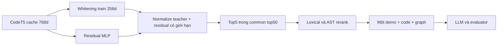
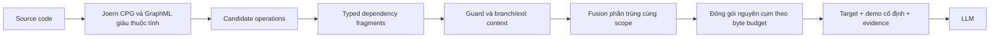
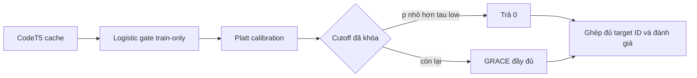
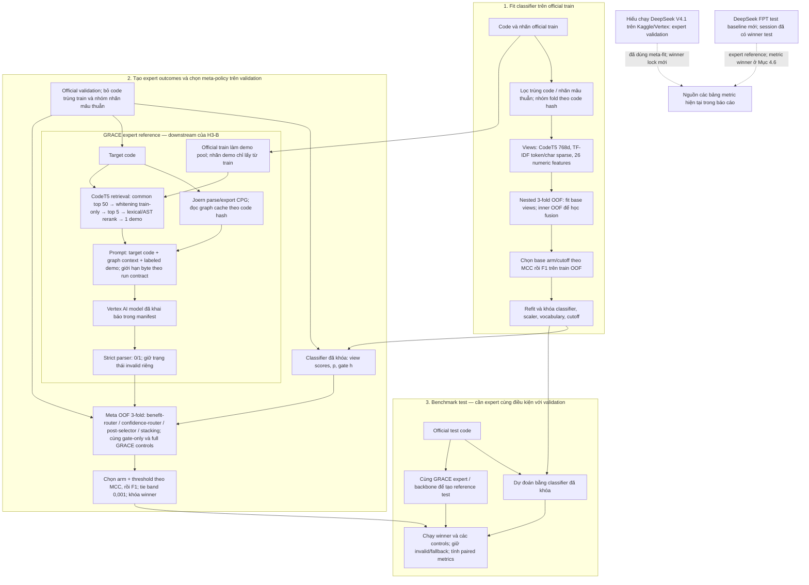
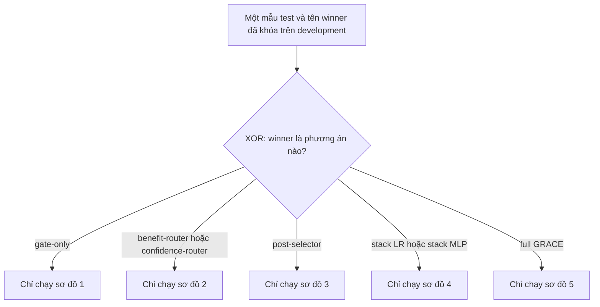
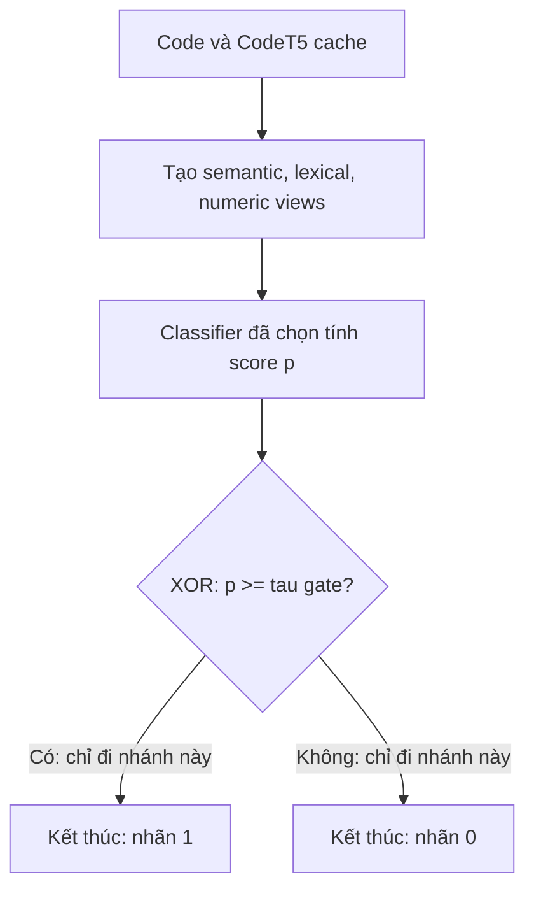
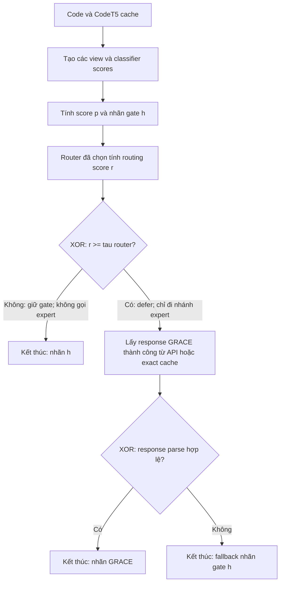
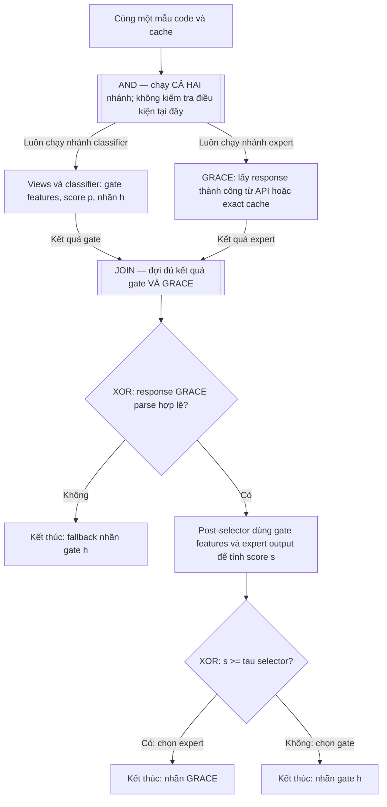
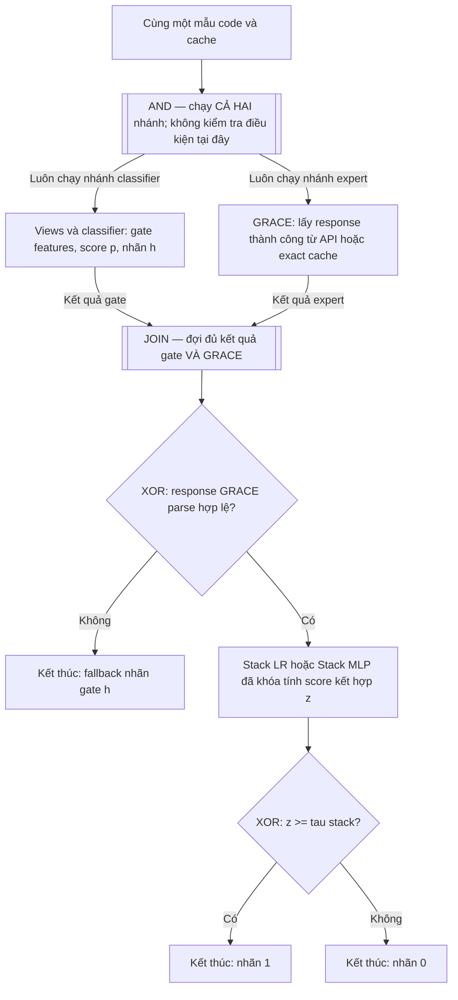
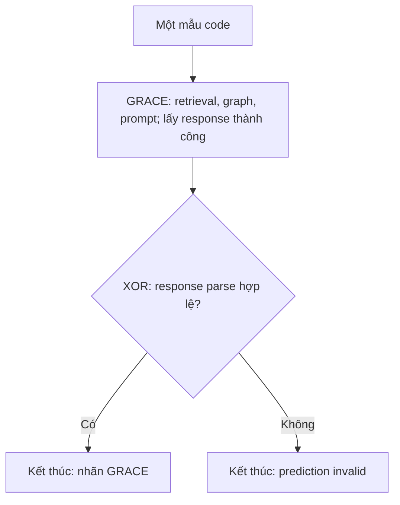

# Báo cáo các hướng cải tiến GRACE: H1, H2 và hai phiên bản H3

Ngày đối chiếu mã nguồn và các tệp kết quả đã lưu: **20/10/2026**.

> **Cập nhật đối soát 24/10/2026:** đã bổ sung phân tích paired cho H1/H3-A và session H3-B đã có test; xem Mục 6 và [bản đối soát riêng](bao_cao_doi_soat_4_huong_H_20261024.md). Các bảng snapshot cũ giữ nguồn và phạm vi riêng.

## Tổng quan và phạm vi đóng góp

Báo cáo trình bày ba hướng thay đổi trong GRACE; H1 có hai phiên bản, còn H3 có hai nhánh thí nghiệm. Các phần gồm biểu diễn dùng để chọn mẫu minh họa (demonstration, gọi tắt là demo), bằng chứng từ graph đưa vào prompt và cách phối hợp bộ phân loại nhỏ với GRACE. Trong báo cáo, “đã triển khai cải tiến” nghĩa là đã có phương pháp và mã nguồn. Chỉ kết luận **cải thiện hiệu quả thực nghiệm** khi có kết quả đối chứng hỗ trợ.

| Hướng | Thành phần được thay đổi | Câu hỏi nghiên cứu chính | Trạng thái bằng chứng hiện có |
|---|---|---|---|
| **H1-V1 — Security Projection** | Projection affine 768→128 và metric learning theo nhãn | Bản triển khai đầu có cải thiện downstream so với whitening không? | Có run Qwen/context 8192; đã bổ sung paired analysis cùng ID ở Mục 6; không có bằng chứng V1 cải thiện |
| **H1-V2 — Security Projection V2** | Residual local metric learning quanh whitening 256 | Biểu diễn residual có chọn demo hữu ích hơn baseline không? | Có paired ReVeal trên 2265 ID, ΔMCC khoảng +0,0019 và CI chứa 0; 9 invalid; chưa có run V2 Devign |
| **H2 — Guarded Evidence** | Chọn và đóng gói graph context | Giữ thao tác, phụ thuộc dữ liệu và điều kiện liên quan thành cụm có giúp LLM hơn graph prefix/slicing không? | Đã có full test Vertex DeepSeek và baseline DeepSeek FPT mới; chưa có đối chứng chỉ đổi evidence với cùng code/demo/budget và cấu hình phục vụ |
| **H3-A — Calibrated Cascade** | Gate và routing trước GRACE | Có thể tự xử lý một phần mẫu với ràng buộc bỏ sót trên validation, giảm số query cần GRACE không? | Có metric Devign và ReVeal khi dùng baseline H1 đã chọn làm expert; Devign bỏ qua 6/2.732 mẫu (0,22%), ReVeal không bỏ qua mẫu nào |
| **H3-B — Benchmark Ensemble** | Classifier nhiều view, meta-router/selector/stacking phối hợp với GRACE | Khi nào nên dùng classifier, khi nào GRACE bổ sung giá trị? | Đã có session train/meta-fit/lock/test DeepSeek; winner gate_tuned, query expert 0. Chưa xác nhận lợi ích kết hợp LLM; xem Mục 4.6 và 6 |

Hai phiên bản H3 có mục tiêu thí nghiệm khác nhau: H3-A ưu tiên routing có ràng buộc; H3-B ưu tiên MCC rồi F1, chấp nhận không giảm số query cần LLM. H1-V1 là lần triển khai đầu; H1-V2 là lần cải tiến tiếp theo. Báo cáo tách metric và kết luận hai phiên bản; không gộp kết quả V1 thành bằng chứng cho V2.

### Mốc tham chiếu: bài báo, code tác giả và baseline đang dùng

GRACE đã kết hợp thông tin graph và demonstration; retrieval vốn đã xét độ tương đồng ngữ nghĩa, từ vựng và cú pháp (semantic, lexical, syntactic similarity). Vì vậy, điểm mới của các hướng dưới đây cần được phân biệt với việc chỉ dùng ba tín hiệu hoặc đưa graph vào prompt. Xem [bài GRACE](https://www.sciencedirect.com/science/article/pii/S0164121224000748) và [repository tác giả](https://github.com/P-E-Vul/GRACE).

| Thành phần | Bài báo GRACE | Code tác giả được đối chiếu | Baseline thực thi của các hướng mới |
|---|---|---|---|
| Biểu diễn code | CodeT5 và giảm chiều theo thiết lập của bài báo | `genexample.py` nạp `RobertaModel` tại đường dẫn tên CodeT5, phụ thuộc `bert_whitening` không có đủ artifact | Dùng đúng T5Encoder, masked mean, vector 768d có hash checkpoint và thứ tự ID; whitening 256 được fit trên train |
| Chọn demo | Kết hợp semantic/lexical/syntactic | Có top-k semantic và rerank `0.7 * code_score + 0.3 * ast_score` | Common top 50 → semantic top 5 → rerank → một demo train có nhãn |
| Graph | Graph structure trong prompt | Phụ thuộc graph/preprocessing của tác giả | H1/H3 dùng bản graph cơ bản đã lưu; H2 cần graph giàu thuộc tính và có đối chứng riêng |
| Backbone | GPT-4 trong thiết lập bài báo | `llmpre.py` gọi `gpt-4` | Các lượt H1/H3-A được dẫn ở đây ghi Qwen3-Coder-480B trên Vertex AI; H3-B dùng validation Vertex DeepSeek và test DeepSeek FPT; khác cấu hình phục vụ được ghi trong manifest |
| Phạm vi so sánh | Kết quả công bố theo protocol bài báo | Chưa đủ artifact để xác nhận tái lập từng chi tiết | Đối chứng nội bộ cùng thiết lập; không quy chênh lệch với kết quả GPT-4 trong bài báo cho riêng cải tiến |

Mã nguồn và hồ sơ đối chiếu trên máy: [genexample.py](D:/JUNIOR/LabThayTho/GRACE-original-code/genexample.py), [llmpre.py](D:/JUNIOR/LabThayTho/GRACE-original-code/llmpre.py), [H1 reference.py](D:/JUNIOR/LabThayTho/GRACE-H1-SecurityProjection/grace_h1/reference.py), [audit baseline H2](D:/JUNIOR/LabThayTho/GRACE-H2-GuardedEvidence/docs/BASELINE_AUDIT.md).

**Điều kiện đánh giá:** giữ nguyên tập mẫu (cohort) và kho retrieval đã chốt cho từng lượt. Khi retrieval và tạo prompt, chỉ được dùng nhãn của demo thuộc train; nhãn target chỉ được mở lúc đánh giá. Parser chỉ nhận dòng cuối chính xác là `0` hoặc `1`; trường hợp lỗi được giữ là invalid. Báo cáo gồm metric, coverage và hai đối chứng luôn đoán vulnerable/non-vulnerable. Khi xác nhận một so sánh, dùng cùng tập ID hợp lệ và khoảng tin cậy (CI) ghép cặp. Không mặc định các tệp kết quả lịch sử đều theo contract hiện tại 24.000 byte; điều kiện thực chạy phải lấy từ manifest/freeze của từng run.

## 1. H1 — hai phiên bản cải tiến SecurityProjection — [mã nguồn](https://github.com/kazunguyen/GRACE-H1-SecurityProjection)

### 1.1. H1-V1 — bản cải tiến lần đầu

H1-V1 bổ sung projection affine 768→128, chuẩn hóa biểu diễn và classifier phụ trên baseline whitening. Objective kết hợp weighted cross-entropy, supervised contrastive loss và hard-negative loss trong batch. Đây là lần triển khai H1 đầu tiên; H1-V2 được trình bày riêng từ mục 1.2.

**Benchmark Vertex Qwen, context 8192:** arm cải tiến của V1 là `h1_supcon_hard`. Baseline dùng đúng hai run đã khóa: Devign `9afe3268729648c6` và ReVeal `0779c879b6d11431`. Confusion matrix theo thứ tự TN / FP / FN / TP.

| Dataset | Phiên bản / arm | Valid / invalid | TN / FP / FN / TP | Accuracy | Precision | Recall | F1 | MCC | Balanced accuracy |
|---|---|---:|---|---:|---:|---:|---:|---:|---:|
| Devign | Baseline whitening — `9afe3268729648c6` | 2.732 / 0 | 1.146 / 331 / 910 / 345 | 54,58% | 51,04% | 27,49% | 35,73% | 0,0587 | 52,54% |
| Devign | H1-V1 `h1_supcon_hard` — `7c4a52705268af6f` | 2.720 / 0 | 1.116 / 355 / 919 / 330 | 53,16% | 48,18% | 26,42% | 34,13% | 0,0263 | 51,14% |
| ReVeal | Baseline whitening — `0779c879b6d11431` | 2.274 / 0 | 1.483 / 561 / 156 / 74 | 68,47% | 11,65% | 32,17% | 17,11% | 0,0318 | 52,36% |
| ReVeal | H1-V1 `h1_supcon_hard` — `d318d1344264b913` | 2.205 / 0 | 1.451 / 530 / 155 / 69 | 68,93% | 11,52% | 30,80% | 16,77% | 0,0275 | 52,02% |

Theo metric điểm, H1-V1 có F1 thấp hơn baseline 1,60 điểm phần trăm trên Devign và 0,34 điểm trên ReVeal; MCC cũng thấp hơn trên cả hai tập. 12 raw row Devign và 69 raw row ReVeal thiếu model/provider nên bị loại trước khi xác nhận request Qwen đủ điều kiện. Vì số mẫu hợp lệ khác nhau, các metric điểm trong bảng này chưa cùng cohort; paired analysis cập nhật ở Mục 6, không thay đổi số liệu snapshot.

Nguồn metric và artifact theo run: [bảng metric H1-V1/V2](metric_cai_tien_vertex_qwen_context8192.md).

Một snapshot lịch sử khác từng ghi H1 linear 128 có F1/MCC 34,33%/0,0280 trên Devign và 16,61%/0,0246 trên ReVeal. Đó là lượt chạy trước, không cùng benchmark context 8192 ở bảng trên; không trộn các snapshot đó với kết quả V1/V2 hiện tại.

### 1.2. H1-V2 — giả thuyết cải tiến và nguồn nghiên cứu

H1 V2 học một điều chỉnh nhỏ trên biểu diễn whitening, ưu tiên các cặp train gần nhau về ngữ nghĩa và giữ quan hệ tương đồng giữa các mẫu. Giả thuyết là cách này có thể thích nghi theo nhãn mà ít làm xáo trộn các vùng lân cận về chức năng (neighborhood) hơn.

| Căn cứ | Nguyên lý được sử dụng | Phần thích nghi của dự án |
|---|---|---|
| [SupCon — Khosla et al., 2020](https://proceedings.neurips.cc/paper_files/paper/2020/hash/d89a66c7c80a29b1bdbab0f2a1a94af8-Abstract.html) | Dùng nhãn để học representation tương phản | V2 chỉ chọn positive cùng nhãn trong neighborhood train, thay vì coi mọi hàm cùng nhãn là tương đương chức năng |
| [Sampling Matters — Wu et al., 2017](https://arxiv.org/abs/1706.07567) | Cách lấy cặp ảnh hưởng mạnh đến metric learning | Dùng bank local, nhiều negative và semi-hard phụ có warmup; không triển khai nguyên distance-weighted sampler của bài |
| [Similarity-Preserving KD — Tung & Mori, 2019](https://arxiv.org/abs/1907.09682) | Giữ quan hệ tương đồng giữa các mẫu khi học biểu diễn mới | Teacher là whitening train, loss là cosine-Gram MSE; không sao chép nguyên loss row-normalized của bài |
| [EPR — Rubin et al., 2022](https://aclanthology.org/2022.naacl-main.191/) | Retriever cho in-context learning cần gắn với tác dụng của demo đối với LM | Dùng làm căn cứ đánh giá downstream; V2 hiện chưa học từ counterfactual LLM utility như EPR |

Các nguồn này là căn cứ cho thiết kế và cách chọn đối chứng, chưa chứng minh V2 sẽ tăng MCC trong GRACE. Biến thể của dự án kết hợp residual có giới hạn, local metric loss, ràng buộc geometry và tiêu chí chọn mô hình như mô tả dưới đây.

### 1.3. H1-V2 — thay đổi cụ thể đã triển khai



| Thành phần | H1 cũ | H1 V2 hiện tại |
|---|---|---|
| Projection | Affine 768→128 | MLP 768→256→256 với GELU, dropout 0,1 và residual quanh teacher 256 |
| Điểm bắt đầu | Projection được học riêng | Lớp residual cuối khởi tạo 0, bắt đầu từ whitening teacher |
| Cặp tương phản | Same-label trong batch, hardest negative | Local positive bank 8, negative bank 32; mỗi anchor lấy 1 positive và 8 negative |
| Cân bằng | Weighted CE theo tần suất | Anchor batch 128 cân bằng hai lớp; CE không bù inverse-frequency thêm |
| Giữ semantic | Không có geometry loss riêng | MSE giữa các cosine similarity ngoài đường chéo của batch và teacher |
| Chọn head | MCC classifier validation | Macro label P@5 trong common pool, kèm ràng buộc theo từng lớp và overlap |
| Kích thước | 98.690 tham số | 263.170 tham số, gồm classifier phụ |

Với embedding \(e\), biểu diễn chuẩn hóa theo train \(u\) và teacher whitening \(t\):

\[
u=(e-\mu_{train})/\sigma_{train},\quad
r=W_2\,Dropout(GELU(W_1u+b_1))+b_2,
\]
\[
\delta=\frac{r}{1+\|r\|_2},\qquad z=normalize(t+0.25\delta).
\]

Residual có norm nhỏ hơn 0,25 trước bước chuẩn hóa; đây là giới hạn biên độ điều chỉnh, **không bảo đảm top-k giữ nguyên**. Classifier 256→2 chỉ hỗ trợ học/chọn head; dự đoán cuối vẫn là GRACE+LLM.

Hàm mục tiêu (objective) của arm đầy đủ:

\[
L=L_{CE}+0.1L_{local\ InfoNCE}+0.05\,ramp(epoch)L_{semi-hard}+1.0L_{geometry}.
\]

Semi-hard chọn negative thỏa \(sim_{pos}-0.2<sim_{neg}<sim_{pos}\), với warmup 3 epoch và ramp 5 epoch. Khi không có cặp thỏa điều kiện, thành phần loss này bằng 0; local InfoNCE vẫn học trên nhiều negative. Huấn luyện dùng AdamW, learning rate \(3\times10^{-4}\), weight decay \(10^{-3}\), tối đa 30 epoch, patience 8 và seed 42.

Teacher và các tham số chuẩn hóa chỉ được fit trên train; mining cũng chỉ dùng train. Trong tập học, các đoạn code trùng nhau và cùng nhãn được gộp lại, còn nhóm có nhãn mâu thuẫn bị loại. Kho train dùng cho retrieval vẫn giữ theo cohort đã chốt. Checkpoint chỉ được chấp nhận nếu macro P@5 hơn teacher ít nhất 0,002, không lớp nào giảm hơn 0,02 và overlap top 5 ít nhất 0,5; nếu không đạt thì dùng biểu diễn identity và ghi nhận fallback.

Code: [projection_v2.py](D:/JUNIOR/LabThayTho/GRACE-H1-SecurityProjection/grace_h1/projection_v2.py), [experiment_v2.py](D:/JUNIOR/LabThayTho/GRACE-H1-SecurityProjection/grace_h1/experiment_v2.py), [cấu hình V2](D:/JUNIOR/LabThayTho/GRACE-H1-SecurityProjection/configs/projection_v2.json).

### 1.4. H1-V2 — ví dụ trước/sau

Hai trường hợp thực tế từ lượt V2 ReVeal; ID demo dưới đây viết gọn phần source ID và chỉ số dòng, đầy đủ nằm trong `retrieval.jsonl`:

| Target / nhãn thật | Demo whitening → demo V2 | Dự đoán trước → sau | Quan sát |
|---|---|---|---|
| `reveal:test:5610242550647094255#1323`, nhãn 0 | `6871081691104220210#3834` → `-7990991774694156606#16338` | 1→0 | Sửa một false positive |
| `reveal:test:-7777644912037188223#741`, nhãn 0 | `-5082285935423529157#2449` → `-3456072850741599569#15654` | 0→1 | Tạo thêm một false positive |

V2 đổi demo ở 126/2.274 target, khoảng 5,54%. Hai ví dụ cho thấy đầu vào đã thay đổi, nhưng chưa đủ để quy mọi thay đổi dự đoán cho chất lượng demo. Kiểm tra bổ sung còn thấy **6 target có cùng prompt hash nhưng hai arm có prediction hợp lệ khác nhau**. Vì vậy, temperature 0/seed 42 không bảo đảm hai lượt API cho kết quả giống hệt nhau. Khi cần tách riêng tác dụng của retrieval, phải kiểm soát việc dùng lại response hoặc đo lặp.

Nguồn: [retrieval baseline](D:/JUNIOR/LabThayTho/GRACE-H1-SecurityProjection/runs/reveal/test/baseline_whitening/2d1845eabf62eb84/retrieval.jsonl), [retrieval V2](D:/JUNIOR/LabThayTho/GRACE-H1-SecurityProjection/runs/reveal/test/h1_residual_local/98d7f32cd098d4c0/retrieval.jsonl), prediction tại cùng hai thư mục và [nhãn test](D:/JUNIOR/LabThayTho/GRACE-H1-SecurityProjection/data/reveal/test.jsonl).

### 1.5. H1-V2 — thiết kế đối chứng

Đối chứng chính là whitening 256 cùng encoder masked-mean, common pool, rerank, một demo, graph policy, prompt và backbone. Giữ số chiều 256 ở cả baseline và V2 để không gộp thêm tác dụng của việc đổi số chiều. Đối chứng `residual_ce` giữ kiến trúc, cách lấy mẫu và geometry nhưng bỏ local và semi-hard; `residual_local` dùng hàm mục tiêu đầy đủ. H1 linear 128 chỉ là mốc lịch sử; chưa có lượt paired mới cùng điều kiện để kết luận V2 hơn H1 cũ.

Checkpoint được chọn theo kết quả retrieval trên validation. Ở bước chạy LLM đầy đủ, hiện có so sánh whitening với `h1_residual_local` trên ReVeal test. Tập test này đã được xem trong nghiên cứu trước nên không được coi là holdout hoàn toàn mới. Các ablation bỏ geometry, locality hoặc semi-hard chưa có đủ kết quả LLM để tách đóng góp của từng thành phần loss.

### 1.6. H1-V2 — kết quả và giải thích

**Retrieval validation:** 2.204 target sau lọc trùng train; head được học trên 17.761 mẫu train không trùng và không mâu thuẫn nhãn, từ 18.187 mẫu train gốc.

| Representation | Macro label P@5 | Hit@5 macro | Overlap top 5 với teacher | Checkpoint |
|---|---:|---:|---:|---|
| Whitening 256 | 0,62663 | 0,90400 | 1,00000 | Teacher |
| Residual CE | 0,63490 | 0,88996 | 0,93593 | Epoch 4 |
| Residual local | 0,63611 | 0,90962 | 0,92949 | Epoch 2 |

Nguồn: [training_selection.json](D:/JUNIOR/LabThayTho/GRACE-H1-SecurityProjection/artifacts/projection_v2/training_selection.json). Các chỉ số retrieval đo mức khớp nhãn của retrieval; chúng chưa cho biết demo có cùng cơ chế lỗ hổng với target hoặc có hữu ích cho LLM hay không.

**Full GRACE — benchmark Vertex Qwen, context 8192:** đây là phần đánh giá **H1 V2 (`residual_local`)**. Baseline được khóa theo đúng hai run bạn chỉ định: Devign `baseline_whitening` / `9afe3268729648c6` và ReVeal `baseline_whitening` / `0779c879b6d11431`. Bảng chỉ đưa các kết quả của baseline và H1 V2; các arm H1 V1 như `h1_supcon_hard` không gộp vào kết quả V2. Confusion matrix theo thứ tự TN / FP / FN / TP.

| Dataset / run | Phiên bản / arm | Valid / invalid | TN / FP / FN / TP | Accuracy | Precision | Recall | F1 | MCC | Balanced accuracy |
|---|---|---:|---|---:|---:|---:|---:|---:|---:|
| Devign — `9afe3268729648c6` | Baseline whitening | 2.732 / 0 | 1.146 / 331 / 910 / 345 | 54,58% | 51,04% | 27,49% | 35,73% | 0,0587 | 52,54% |
| ReVeal — `0779c879b6d11431` | Baseline whitening | 2.274 / 0 | 1.483 / 561 / 156 / 74 | 68,47% | 11,65% | 32,17% | 17,11% | 0,0318 | 52,36% |
| ReVeal — `98d7f32cd098d4c0` | H1 V2 `residual_local` | 2.265 / 9 | 1.493 / 544 / 155 / 73 | 69,14% | 11,83% | 32,02% | 17,28% | 0,0359 | 52,66% |

Nguồn metric: bảng H1 và phần đánh giá H3-A trong [bảng metric tổng hợp](metric_cai_tien_vertex_qwen_context8192.md). Trên ReVeal, điểm của H1 V2 cao hơn baseline **0,17 điểm phần trăm F1** và MCC tăng **0,0041**. Tuy nhiên, V2 có 9 invalid còn baseline đủ 2.274 mẫu; đây là metric valid-only; paired analysis mới trên 2265 ID cho CI ΔMCC chứa 0 (Mục 6), nên chưa đủ để kết luận V2 cải thiện downstream. Trên Devign hiện có baseline theo run đã chọn nhưng **chưa có benchmark H1 V2 tương ứng**, vì vậy không thể kết luận V2 trên dataset này.

### 1.7. H1-V2 — giới hạn và kết luận

H1 V2 đã thay đổi cơ chế biểu diễn, có đối chứng về kiến trúc và dùng tiêu chí chọn mô hình sát với mục tiêu retrieval hơn bản cũ. Chỉ số đánh giá gián tiếp (proxy) có tăng, nhưng **chưa chứng minh tăng MCC/F1 của full GRACE**. Hai điểm cần xác nhận là tác dụng thực tế của demo và biến động của LLM khi prompt giống nhau. Bằng chứng hiện tại hỗ trợ thiết kế này, chưa đủ để kết luận V2 vượt H1 cũ hoặc baseline trên cả hai dataset.

## 2. H2 — Guarded Evidence: giữ bằng chứng và điều kiện liên quan trong graph context — [mã nguồn](https://github.com/kazunguyen/GRACE-H2-GuardedEvidence)

### 2.1. Vấn đề của cách hiện tại

Graph prefix có thể giữ nhiều node đầu nhưng bỏ mất điều kiện quyết định ở phía sau. Slicing từ sink có thể giữ được quan hệ phụ thuộc nhưng vẫn thiếu nhánh thoát, chiều đúng/sai của nhánh hoặc khai báo biến. Dạng graph text cũ còn có thể mất ID gốc của node (native node IDs), vị trí trong mã nguồn và thuộc tính cạnh. Khi đó, chưa đủ bằng chứng để khẳng định một guard bảo vệ một thao tác cụ thể.

Baseline đã có graph và một số cấu hình thí nghiệm (arm) dùng slicing/verbalization. H2 bổ sung **fragment có loại quan hệ, ngữ cảnh guard/exit, phạm vi (scope) và cách đóng gói nguyên cụm theo budget**. Đây là phần khác biệt cần đối chiếu với GraphVerb.

### 2.2. Giả thuyết cải tiến và nguồn nghiên cứu

Với cùng target/demo/LLM, context giữ trọn quan hệ giữa thao tác, dữ liệu và điều kiện có thể giúp LLM phân biệt có kiểm tra với thiếu kiểm tra tốt hơn graph prefix hoặc slicing thuần túy. Giảm số node chỉ có ý nghĩa khi vẫn giữ được bằng chứng phản bác nhận định có lỗ hổng (counterevidence).

- [CPG — Yamaguchi et al., 2014](https://www.ieee-security.org/TC/SP2014/papers/ModelingandDiscoveringVulnerabilitieswithCodePropertyGraphs.pdf): kết hợp AST, CFG và program dependence để truy vấn mã. H2 kế thừa cách giữ quan hệ có loại, không coi các loại cạnh là một quan hệ chung.
- [SliceLocator v4](https://arxiv.org/html/2401.02737v4), §4.1: bắt đầu từ potential sink rồi truy ngược data/control dependencies. H2 dùng nguyên lý gắn evidence với thao tác, không dùng GNN chấm path như bài báo.
- [VulDIAC](https://www.sciencedirect.com/science/article/pii/S016412122500264X): sử dụng ACFG để bổ sung ngữ nghĩa quan hệ chương trình. H2 vận dụng cách giữ ngữ cảnh điều khiển/định nghĩa (control/definition context), không triển khai RGCN-CAL và không tuyên bố đã phân tích nhân quả.
- [MDVul, DOI 10.1016/j.inffus.2025.103475](https://doi.org/10.1016/j.inffus.2025.103475): là căn cứ trong hồ sơ nghiên cứu nội bộ cho dependency-flow và fusion. H2 định nghĩa lại overlap theo tập node và scope, không chuyển toàn bộ detector sang dự án. Vị trí tra cứu phương pháp và PDF được ghi trong [RESEARCH_EVIDENCE.md](D:/JUNIOR/LabThayTho/GRACE-H2-GuardedEvidence/docs/RESEARCH_EVIDENCE.md); trang publisher không tải được tại thời điểm đối chiếu nguồn.

### 2.3. Thay đổi cụ thể đã triển khai



Một cụm evidence gồm thao tác (operation), đối số/khai báo liên quan (argument/declaration), node và cạnh phụ thuộc, điều kiện điều khiển, ngữ cảnh nhánh/thoát và thông tin nguồn nếu có. Thuộc tính bị thiếu được ghi là `unknown`; không suy đoán dòng mã nguồn hoặc chiều đúng/sai của nhánh (branch polarity).

Quy trình hiện thực:

1. Import graph cùng ID gốc, loại và thuộc tính của node/cạnh, hash của code/CPG/GraphML và metadata của bộ công cụ. Xác nhận node thuộc hàm nào theo METHOD/AST và báo cáo khả năng hỗ trợ (capability report).
2. Tạo seed từ AST calls, indexing, indirection, allocation/lifetime, parameter và size arithmetic; danh sách API chỉ bổ sung seed, không đóng vai trò bộ kết luận lỗ hổng.
3. Truy ngược dependency và giữ riêng loại quan hệ `REACHING_DEF`, `CDG`, `DOMINATE`, `POST_DOMINATE`, argument/reference. Giới hạn depth 8, 64 fragment/query và 256 node được duyệt/seed; có kiểm soát chu trình.
4. Với `H2-guarded`, bổ sung predicate, các node kế tiếp trong CFG cục bộ và ngữ cảnh thoát quan sát được. Quan hệ dominance chưa bảo đảm điều kiện đủ để ngăn lỗi; alias, overflow, signedness và hành vi wrapper vẫn có thể chưa xác định.
5. Gộp các cụm cùng scope khi Jaccard node overlap đạt ít nhất 0,5; giữ lại bản ghi seed/branch để truy được nguồn gốc.
6. Đóng gói tham lam (greedy packing) theo **mức tăng coverage của operation/role/declaration trên chi phí byte tăng thêm**, giữ nguyên từng cụm; tối đa 40 node gốc, 80 cạnh quan sát được và graph budget 512/1.024/2.048 byte. Cách đóng gói này là heuristic, không được coi là tối ưu toàn cục.

Nếu không có cụm hoàn chỉnh nào vừa budget, hệ thống dùng B2 prefix làm phương án dự phòng (fallback) và ghi rõ lý do. Lỗi schema/hash phải được báo riêng, không được che bằng fallback. Renderer trình bày dữ kiện graph và đánh dấu phần chưa biết, không tự kết luận về tính an toàn. Đặc tả loại cạnh được đối chiếu với [Joern CPG specification](https://cpg.joern.io/).

Code: [evidence.py](D:/JUNIOR/LabThayTho/GRACE-H2-GuardedEvidence/grace_h2/evidence.py), [guards.py](D:/JUNIOR/LabThayTho/GRACE-H2-GuardedEvidence/grace_h2/guards.py), [fusion.py](D:/JUNIOR/LabThayTho/GRACE-H2-GuardedEvidence/grace_h2/fusion.py), [graph_store.py](D:/JUNIOR/LabThayTho/GRACE-H2-GuardedEvidence/grace_h2/graph_store.py).

### 2.4. Ví dụ trước/sau

Ví dụ **minh họa cơ chế**, không phải ca benchmark đã chứng minh H2 dự đoán đúng:

```c
int copy_data(char *dst, size_t cap, const char *src, size_t n) {
    if (n > cap) return -1;
    memcpy(dst, src, n);
    return 0;
}
```

| Context có thể gặp trước H2 | Context H2 muốn giữ |
|---|---|
| Node `memcpy` và biến `n`, nhưng thiếu predicate do prefix/cap | Operation `memcpy(dst,src,n)` cùng argument/declaration, predicate `n > cap`, early return và cạnh control quan sát được |
| Các node/edge rời nhau, người đọc khó biết thuộc cùng biến/scope | Native IDs, loại quan hệ và scope của cùng cụm |
| Không thấy guard, dễ diễn giải thành không tồn tại guard | Nếu graph thiếu CDG/CFG thì ghi availability unknown |

Ngay cả khi giữ được `n > cap`, H2 vẫn chưa thể khẳng định hàm an toàn: cần xét độ hợp lệ của con trỏ, dung lượng thực của `dst`, nguồn `src` và hành vi wrapper. Có thể bỏ dòng guard để tạo ví dụ đối lập nhằm kiểm tra extractor có phân biệt được evidence hay không; không mặc định phép thay đổi này quyết định nhãn benchmark của toàn hàm.

### 2.5. Thiết kế đối chứng

H2 còn thay đổi cách biểu diễn AST so với baseline H1, nên cần tách ảnh hưởng này khỏi tác dụng của evidence:

| Arm | Vai trò |
|---|---|
| `B0-edge-native` | Baseline AST edge strings, substitution cost 2 |
| `B1-simsbt-native` | AST type preorder theo ORDER, edit cost 1; control riêng cho đổi AST |
| `B2-prefix-matched` | Prefix graph nhưng cùng renderer và byte budget với H2 |
| `C-slice-matched` | Slicing control, cùng graph source/renderer/budget |
| `H2-flow` | Dependency fragments |
| `H2-fusion` | Fragments và fusion |
| `H2-guarded` | Fusion cùng guard/exit context |

So sánh B0↔B1 để đo ảnh hưởng của việc đổi AST. Để đo tác dụng của evidence, các arm đối chứng tương ứng phải **giữ cùng target/demo và prefix hash**. Nếu H2 thay đổi cả AST và graph so với baseline thì không thể quy toàn bộ mức tăng cho evidence.

Target prefix tối đa 3.000 UTF-8 byte, demo 1.500 byte, một demo; graph budget được quét trên validation và prompt tổng tối đa 24.000 byte. Chọn arm và budget trên validation, rồi khóa cấu hình trước khi tạo test. H2 không bật thêm H1, GEPA, MMR hoặc bốn demo trong thí nghiệm độc lập. Quy trình khóa cấu hình test hiện yêu cầu arm H2 được chọn cùng B1 và C-slice. Khi đối soát graph, vẫn cần B2 tương ứng để tách ảnh hưởng của renderer và budget.

Nguồn: [experiment.yaml](D:/JUNIOR/LabThayTho/GRACE-H2-GuardedEvidence/configs/experiment.yaml), [pipeline.py](D:/JUNIOR/LabThayTho/GRACE-H2-GuardedEvidence/grace_h2/pipeline.py), [protocol](D:/JUNIOR/LabThayTho/GRACE-H2-GuardedEvidence/docs/EXPERIMENT_PROTOCOL.md).

### 2.6. Kết quả và giải thích

**Kết quả full test:** nhánh H2 dùng DeepSeek-V4.1-Flash có 5.006 request hợp lệ. Raw prompt và code hash khớp prompt bundle v3. Hai dòng ghi **Baseline H1 (tham chiếu)** là run Qwen `baseline_whitening`; đây là mốc tham khảo lịch sử, chưa phải đối chứng cùng model để kết luận hiệu quả cải tiến.

| Dataset / split | Nhánh | Model | Run / Arm | Valid / invalid | N0 / N1 | Prediction 0 / 1 | TN / FP / FN / TP | Accuracy (%) | Precision / Recall / F1 (%) | MCC | Balanced accuracy (%) | Coverage (%) | Artifacts |
|---|---|---|---|---:|---:|---:|---|---:|---:|---:|---:|---:|---|
| devign / test | H2 | DeepSeek-V4.1-Flash / Vertex | `H2-guarded-v3` | 2.732 / 0 | 1.477 / 1.255 | 1.702 / 1.030 | 956 / 521 / 746 / 509 | 53,62 | 49,42 / 40,56 / 44,55 | 0,0543 | 52,64 | 100,00 | [evaluation](additional_runs/kaggle_deepseek_v41_20261023/devign/evaluation.json) · [raw + prompts](additional_runs/kaggle_deepseek_v41_20261023/devign/raw_responses.jsonl) · [manifest](additional_runs/kaggle_deepseek_v41_20261023/devign/run_manifest.json) |
| devign / test | **Baseline H1 (tham chiếu)** | Qwen3-Coder-480B / Vertex / context 8192 | `9afe3268729648c6` | 2.732 / 0 | 1.477 / 1.255 | 2.056 / 676 | 1.146 / 331 / 910 / 345 | 54,58 | 51,04 / 27,49 / 35,73 | 0,0587 | 52,54 | 100,00 | [raw](additional_runs/improvements_20261021/GRACE-H1-SecurityProjection/archives/devign/2026-10-16/runs/devign/test/baseline_whitening/9afe3268729648c6/raw_responses_archive.jsonl) · [prompt](additional_runs/improvements_20261021/GRACE-H1-SecurityProjection/archives/devign/2026-10-16/runs/devign/test/baseline_whitening/9afe3268729648c6/prompts.jsonl) · [prediction](additional_runs/improvements_20261021/GRACE-H1-SecurityProjection/archives/devign/2026-10-16/runs/devign/test/baseline_whitening/9afe3268729648c6/predictions.jsonl) |
| reveal / test | H2 | DeepSeek-V4.1-Flash / Vertex | `H2-guarded-v3` | 2.274 / 0 | 2.044 / 230 | 2.120 / 154 | 1.917 / 127 / 203 / 27 | 85,49 | 17,53 / 11,74 / 14,06 | 0,0663 | 52,76 | 100,00 | [evaluation](additional_runs/kaggle_deepseek_v41_20261023/reveal/evaluation.json) · [raw + prompts](additional_runs/kaggle_deepseek_v41_20261023/reveal/raw_responses.jsonl) · [manifest](additional_runs/kaggle_deepseek_v41_20261023/reveal/run_manifest.json) |
| reveal / test | **Baseline H1 (tham chiếu)** | Qwen3-Coder-480B / Vertex / context 8192 | `0779c879b6d11431` | 2.274 / 0 | 2.044 / 230 | 1.639 / 635 | 1.483 / 561 / 156 / 74 | 68,47 | 11,65 / 32,17 / 17,11 | 0,0318 | 52,36 | 100,00 | [raw](additional_runs/improvements_20261021/GRACE-H1-SecurityProjection/runs/reveal/test/baseline_whitening/0779c879b6d11431/raw_responses_archive.jsonl) · [prompt](additional_runs/improvements_20261021/GRACE-H1-SecurityProjection/runs/reveal/test/baseline_whitening/0779c879b6d11431/prompts.jsonl) · [prediction](additional_runs/improvements_20261021/GRACE-H1-SecurityProjection/runs/reveal/test/baseline_whitening/0779c879b6d11431/predictions.jsonl) |

Do DeepSeek và baseline H1 dùng khác model, các dòng H1 chỉ để tham khảo mốc lịch sử; không dùng chênh lệch metric trong bảng này để kết luận H2 tốt hơn hay kém baseline.

Nguồn DeepSeek: [evaluation/raw/manifest Devign](additional_runs/kaggle_deepseek_v41_20261023/devign/run_manifest.json), [evaluation/raw/manifest ReVeal](additional_runs/kaggle_deepseek_v41_20261023/reveal/run_manifest.json). Nguồn baseline Qwen và quy tắc lọc request: [bảng metric tổng hợp](metric_cai_tien_vertex_qwen_context8192.md).

### 2.7. Giới hạn và kết luận

Đã có thêm baseline DeepSeek-V4.1-Flash/FPT test ngày 24/10; tuy nhiên chưa phải prefix control cùng builder/code/demo/cap/budget với H2 Vertex. Các run Qwen `baseline_whitening` của H1 được giữ làm số liệu tham khảo lịch sử, không phải đối chứng hợp lệ để kết luận cải tiến có hiệu quả hay không. Khác biệt về model/provider và cấu hình prompt khiến phép so sánh chéo này không cô lập được tác động của H2.

Kết quả hiện tại xác nhận nhánh H2 đã hoàn tất full test trên Devign và ReVeal, nhưng chưa trả lời được câu hỏi H2 có tốt hơn baseline hay không. Cần tạo baseline control theo cùng policy H2 và chốt cấu hình phục vụ cho hai arm; dùng paired analysis để đo phần evidence thay đổi. Không lấy khác biệt với baseline FPT khác policy làm tác động riêng của H2.

## 3. H3-A — Calibrated Cascade: routing có ràng buộc trước GRACE — [mã nguồn](https://github.com/kazunguyen/GRACE-H3-CalibratedCascade)

### 3.1. Vấn đề của cách hiện tại

Full GRACE phải chạy graph/retrieval/prompt/LLM cho mọi query chưa có cache. Một classifier nhỏ có thể xử lý một phần dữ liệu, nhưng bỏ qua mẫu chỉ vì điểm thấp có thể làm sót mẫu vulnerable. Vì vậy, cần đo đồng thời mức tiết kiệm và lỗi do gate tạo ra trên toàn bộ tập mẫu, thay vì chỉ đánh giá nhánh được chuyển đến LLM.

Dự án đã có cascade/filter từ trước. H3-A bổ sung gate chạy trên CPU, tách bước hiệu chuẩn (calibration) khỏi bước chọn ngưỡng (threshold selection), routing có ràng buộc và đánh giá toàn cohort có ghi rõ nguồn gốc kết quả cùng cách dùng cache.

### 3.2. Giả thuyết cải tiến và căn cứ

Gate được học trên CodeT5 cache và hiệu chuẩn xác suất. Gate chỉ tự trả 0 trong vùng mà dữ liệu chọn ngưỡng hỗ trợ giới hạn bỏ sót; các mẫu còn lại vẫn được dự đoán bằng GRACE. Nếu không có cutoff đạt điều kiện, toàn bộ mẫu được chuyển sang GRACE.

[Guo et al., 2017](https://proceedings.mlr.press/v70/guo17a.html) là căn cứ để phân biệt điểm tin cậy (confidence) với calibration. H3-A dùng sigmoid Platt hai tham số, không phải temperature scaling trong bài báo. [Mozannar & Sontag, 2020](https://proceedings.mlr.press/v119/mozannar20b.html) cung cấp khuôn khổ tự dự đoán hoặc chuyển quyết định (defer) cho expert. H3-A dùng chính sách ngưỡng có ràng buộc, chưa triển khai surrogate loss nhất quán của công trình đó. GRACE vẫn có thể dự đoán sai.

#### 3.2.1. Quan hệ với Selective GRACE và giả thuyết lợi thế của H3-A

H3-A có nét tương đồng với phương pháp trong [Deep Learning-Assisted Pre-Filtering for Selective Graph-Structured LLM-Based Vulnerability Detection](https://github.com/kazunguyen/GRACE_runs_context/blob/main/Deep%20Learning-Assisted%20Pre-Filtering%20for%20Selective%20Graph-Structured%20LLM-Based%20Vulnerability%20Detection.pdf) của nhóm **Gia Khanh Tran và Minh Dung Vo** (APSIPA ASC 2026, Mục III-B–III-C, tr. 2–3): cả hai đều học classifier, hiệu chuẩn điểm và chọn ngưỡng để tự xử lý một phần mẫu trước khi chuyển phần còn lại sang GRACE. Bài tham chiếu dùng token, AST-like, semantic và graph-informed numeric views; routing có ba nhánh skip-low, direct-high và inspect. Vì vậy, riêng ý tưởng classifier có hiệu chuẩn và selective routing đã có tiền lệ; H3-A là một biến thể cần được đối chiếu với phương pháp đó.

**Cơ sở để kỳ vọng H3-A có thể tốt hơn ở mục tiêu kiểm soát lỗi bỏ sót, nhưng chưa kiểm chứng:** bài tham chiếu chọn ngưỡng thấp theo target recall 0,995 quan sát trên validation; cùng split còn phục vụ early stopping, lựa chọn/fit calibrator và chọn ngưỡng, và bài đã nêu giới hạn lạc quan do tái sử dụng dữ liệu. H3-A tách validation thành phần fit Platt và phần chọn cutoff; cutoff phải thỏa cận trên Clopper–Pearson một phía cho tỷ lệ positive bị skip, với Bonferroni trên lưới cutoff. Sự tách vai trò dữ liệu và cách xét độ bất định có thể làm việc chấp nhận một vùng skip thận trọng hơn so với chỉ xét recall điểm trên tập chọn ngưỡng. Cận 1% của H3-A và target recall 0,995 của bài tham chiếu là hai tiêu chí khác nhau, không thể dùng riêng hai con số để xếp hạng phương pháp.

H3-A mặc định tắt direct-high và chuyển các trường hợp chưa đủ điều kiện sang expert; cách này có thể phù hợp khi ưu tiên hạn chế quyết định tự động chưa có đủ bằng chứng. Logistic gate trên embedding frozen cũng có thể giảm chi phí học so với bộ prefilter nhiều encoder của bài tham chiếu; ưu thế tài nguyên phải được đo trên cùng phần cứng, tính cả khâu tạo đặc trưng. Các lập luận trên là giả thuyết về kiểm soát rủi ro và chi phí, chưa chứng minh MCC/F1, recall test hay tổng chi phí tốt hơn. Cận thống kê còn phụ thuộc giả định về mẫu và phân bố; GRACE ở nhánh inspect vẫn có thể sai.

**Bằng chứng hiện tại và phép so sánh còn thiếu:** H3-A chỉ bỏ qua 6/2.732 mẫu Devign và không bỏ qua mẫu ReVeal; chưa cho thấy mức tiết kiệm có ích hơn phương pháp của nhóm Gia Khanh Tran và Minh Dung Vo. Muốn kiểm chứng lợi thế cần chạy hai phương pháp trên cùng cohort, retrieval pool, downstream expert/prompt/budget và cùng mục tiêu rủi ro; đo lỗi skip/direct-high, MCC/F1/recall và chi phí ở nhiều seed. Các kết quả của bài tham chiếu trên split/backbone riêng chưa phải đối chứng trực tiếp cho H3-A.

### 3.3. Thay đổi cụ thể đã triển khai



Gate logistic L2 dùng 768 hệ số và 1 hệ số chặn (intercept), chuẩn hóa theo train, C=1 và không gán trọng số lớp. Tập validation dùng cho gate loại code trùng train và nhóm mâu thuẫn nhãn, rồi được chia phân tầng (stratified) theo tỷ lệ 50/50: một nửa fit Platt, nửa còn lại chọn cutoff. Tập train của retrieval và tập test đầy đủ không bị thu hẹp theo tập học gate.

\[
s(x)=w^T\frac{e(x)-\mu_{train}}{\sigma_{train}}+b,\qquad p_c(x)=\sigma(a\,s(x)+c).
\]

Mặc định chỉ bật `skip-low`: \(p_c<\tau_l\Rightarrow\hat y=0\); các mẫu còn lại gọi GRACE. Nhánh direct-high tự trả 1 bị tắt mặc định. Lưới ngưỡng thấp gồm 9 cutoff đã định trước. Chọn cutoff skip nhiều mẫu nhất nhưng vẫn giữ cận trên một phía Clopper–Pearson của \(FN_{skip}/N_{positive,selection}\) không quá 1%. Mức alpha chung 0,05 được hiệu chỉnh Bonferroni theo số cận được thử. Tỷ lệ này có mẫu số là **toàn bộ mẫu positive trong tập chọn ngưỡng**, không phải số mẫu bị skip.

Nếu bật direct-high, cần đồng thời có cận dưới precision ≥ 0,98 và cận trên tỷ lệ false positive ≤ 0,01. Đây là chính sách khác và cần khóa lại trước khi đánh giá. Nếu không có cutoff đủ điều kiện hoặc hệ số dốc của calibration không dương, hệ thống chuyển toàn bộ mẫu sang nhánh inspect (fail-open). Cách tính cận beta-quantile được triển khai trong [gate.py](D:/JUNIOR/LabThayTho/GRACE-H3-CalibratedCascade/grace_h3/gate.py); [SciPy beta](https://docs.scipy.org/doc/scipy/reference/generated/scipy.stats.beta.html) là nguồn API cho `ppf`.

### 3.4. Ví dụ trước/sau

Artifact Devign chọn `tau_low=0.075`. Target `devign:test:982` có calibrated score ≈ 0,06577:

| Full GRACE | H3-A |
|---|---|
| Đi qua graph/retrieval/LLM | Vì 0,06577 < 0,075, chuyển `skip_low`, trả 0 |
| Cần một query GRACE theo thuật toán | Không cần expert query cho target này |

Đây là một trong 6 target được skip; evaluation ghi nhận cả 6 đều là non-vulnerable, skip FN=0. Với score ≥ cutoff, query vẫn dùng GRACE. Prompt hash của nhánh inspect đã được kiểm tra và khớp chính xác với full-reference. Ví dụ cho thấy routing thực tế, chưa chứng minh điểm 0,06577 là xác suất lỗi được bảo đảm trên mọi miền dữ liệu.

Nguồn: [routing.jsonl](D:/JUNIOR/LabThayTho/GRACE-H3-CalibratedCascade/runs/h3/devign/3c90db3984588497/routing.jsonl), [gate manifest](D:/JUNIOR/LabThayTho/GRACE-H3-CalibratedCascade/artifacts/gates/devign/7d08a83e590e5d7d/manifest.json).

### 3.5. Thiết kế đối chứng

Cần đọc cùng ba kết quả: full GRACE dùng cùng downstream, gate-only với cutoff 0,5 và cascade đã khóa. Trên nhánh inspect, cascade/reference phải dùng cùng prompt và cùng response của LLM khi có cache khớp chính xác. Chạy cascade trước, rồi bổ sung full reference cho các query mà gate tự quyết định. Chi phí tạo reference được tách khỏi chi phí triển khai thực tế.

Báo cáo phải ghép đủ 2.732 ID Devign và giữ invalid nếu expert lỗi. Cần ghi riêng skip FN, direct-high FP, tỷ lệ query gọi GRACE, request, retry, cache và token. Nếu thử kết hợp H1+H3, phải so với full H1 dùng cùng head; hiện chưa có bằng chứng lợi ích của hai hướng tự cộng lại.

### 3.6. Kết quả và giải thích

Trong hai bảng dưới đây, **Full GRACE reference** là kết quả khi GRACE dự đoán toàn bộ mẫu; **H3-A cascade** dùng gate để tự gán nhãn cho mẫu đủ điều kiện bỏ qua, còn lại chuyển sang GRACE; **Gate-only cutoff 0,5** là kết quả của gate classifier trên toàn bộ mẫu, ngưỡng dự đoán vulnerable là 0,5 và không gọi GRACE. Nhãn 0 là safe, nhãn 1 là vulnerable. Thứ tự confusion matrix là TP / TN / FP / FN.
Devign test, seed 42, cả ba predictor đều có 2.732 prediction hợp lệ:

| Predictor | TP / TN / FP / FN | Accuracy | Precision | Recall | F1 | MCC | Balanced accuracy |
|---|---|---:|---:|---:|---:|---:|---:|
| Full GRACE reference | 339 / 1.146 / 331 / 916 | 54,36% | 50,60% | 27,01% | 35,22% | 0,05330 | 52,30% |
| H3-A cascade | 339 / 1.147 / 330 / 916 | 54,39% | 50,67% | 27,01% | 35,24% | 0,05411 | 52,33% |
| Gate-only cutoff 0,5 | 547 / 1.135 / 342 / 708 | 61,57% | 61,53% | 43,59% | 51,03% | 0,21731 | 60,22% |

Cascade chuyển 2.726 mẫu sang inspect và skip 6 mẫu: **mức giảm query gọi GRACE theo thuật toán = 6/2.732 ≈ 0,22%**. So với full reference, cascade sửa được 1 false positive, không làm đổi TP/FN. ΔMCC ≈ +0,00081 với CI 95% **[0; 0,00247]**; ΔF1 ≈ +0,0183 điểm phần trăm với CI 95% **[0; 0,0568] điểm phần trăm**. Chênh lệch rất nhỏ và khoảng tin cậy chứa 0, nên chưa đủ để khẳng định có cải thiện đáng kể trên benchmark.

Gate-only có MCC cao hơn full GRACE ≈ 0,1640, query-bootstrap CI 95% **[0,1159; 0,2196]** trong lượt này. Kết quả này cho thấy **routing chưa khai thác được phần tín hiệu mà classifier đã có**; không thể mặc định LLM tốt hơn gate. F1 của gate-only đạt 51,03%, vẫn thấp hơn đối chứng luôn vulnerable ≈ 62,95% trên Devign, trong khi MCC gate cao hơn 0; vì vậy không dùng F1 một mình để kết luận suy biến hay cải thiện.

Lượt cuối gửi 566 request mới cho cascade và 3 request bổ sung reference, đồng thời dùng lại hàng nghìn kết quả trong cache. Vì vậy, không lấy 566/2.732 làm tỷ lệ gọi LLM theo thuật toán; tỷ lệ đúng là 2.726/2.732 ≈ 99,78%. Nguồn toàn bộ số liệu: [experiment_summary.json](D:/JUNIOR/LabThayTho/GRACE-H3-CalibratedCascade/runs/experiment_summary.json).


#### ReVeal test — H3-A cascade

| Predictor | TP / TN / FP / FN | Accuracy | Precision | Recall | F1 | MCC | Balanced accuracy |
| :--- | :--- | ---: | ---: | ---: | ---: | ---: | ---: |
| Full GRACE reference | 74 / 1.483 / 561 / 156 | 68,47% | 11,65% | 32,17% | 17,11% | 0,0318 | 52,36% |
| H3-A cascade | 74 / 1.483 / 561 / 156 | 68,47% | 11,65% | 32,17% | 17,11% | 0,0318 | 52,36% |
| Gate-only cutoff 0,5 | 1 / 2.044 / 0 / 229 | 89,93% | 100,00% | 0,43% | 0,87% | 0,0625 | 50,22% |

Cả 2.274 mẫu đều được chuyển sang GRACE, nên cascade có cùng kết quả với full GRACE và không giảm số query. Đây là metric tính lại từ routing đã lưu và run GRACE `0779c879b6d11431`; không phát sinh API call mới. [Evaluation](audits/h3a_h1_baseline_reuse_20261022/reveal_h1_expert_evaluation.json) · [prediction cascade](audits/h3a_h1_baseline_reuse_20261022/reveal_h1_expert_cascade_predictions.jsonl).
### 3.7. Giới hạn và kết luận

Ràng buộc 1% làm vùng tự quyết định rất nhỏ trong snapshot này. Cận thống kê chỉ đạt mức tin cậy danh nghĩa khi các giả định về dữ liệu được đáp ứng, không bảo đảm recall trên test hoặc khi phân bố thay đổi (domain shift). Bootstrap theo query cũng chưa xử lý đầy đủ sự phụ thuộc giữa các mẫu cùng project/commit. Trên ReVeal, cascade dùng prediction từ GRACE khi inspect. Gate không skip mẫu nào, nên kết quả cascade trùng full GRACE và không giảm lượt gọi. Đây là metric tái dựng từ prediction đã lưu, không phải một lượt chạy LLM mới hay bằng chứng cải thiện chất lượng.

**H3-A đã triển khai và đo được sự đánh đổi giữa lỗi bỏ sót và số lần gọi LLM, nhưng mức tiết kiệm còn nhỏ.** Kết quả tốt hơn của gate-only không thể được tính là thành công của cascade. Điều này dẫn đến hướng H3-B: học khi nào GRACE bổ sung giá trị, thay vì chỉ defer theo confidence.

## 4. H3-B — Benchmark Ensemble: nhiều view và phối hợp theo lợi ích của GRACE — [mã nguồn](https://github.com/kazunguyen/GRACE-H3-BenchmarkEnsembled)

### 4.1. Vấn đề của cách hiện tại

H3-A giữ ràng buộc skip chặt nên phần lớn query vẫn đi qua expert, dù gate-only có kết quả Devign tốt hơn full GRACE ở lượt đã đo. Chỉ dựa vào độ bất định (uncertainty) của gate để defer chưa trả lời được câu hỏi: **expert có thực sự đúng hơn gate ở nhóm đó không?**

Ngoài ra, embedding semantic, dấu hiệu lexical và numeric có thể mang tín hiệu khác nhau. Một gate logistic trên một view có thể bỏ lỡ tương tác, nhưng thêm model không tự bảo đảm ensemble sẽ tốt hơn.

### 4.2. Giả thuyết cải tiến và căn cứ

H3-B kiểm tra hai giả thuyết: classifier dùng nhiều nhóm đặc trưng (view) có thể phân biệt tốt hơn một view; mô hình phối hợp học từ kết quả đúng/sai của hai predictor có thể chọn được những trường hợp GRACE bổ sung giá trị. Việc chọn mô hình ưu tiên MCC, sau đó đến F1; chi phí chỉ dùng để phân xử khi chất lượng gần ngang nhau. Hướng này không bắt buộc giảm số query gọi expert.

Ý tưởng kết hợp nhiều view với selective routing có tiền lệ trong [Deep Learning-Assisted Pre-Filtering for Selective Graph-Structured LLM-Based Vulnerability Detection](https://github.com/kazunguyen/GRACE_runs_context/blob/main/Deep%20Learning-Assisted%20Pre-Filtering%20for%20Selective%20Graph-Structured%20LLM-Based%20Vulnerability%20Detection.pdf) của nhóm **Gia Khanh Tran và Minh Dung Vo** (APSIPA ASC 2026; [ghi chú đối chiếu phương pháp và trang liên quan](https://github.com/kazunguyen/GRACE-H3-BenchmarkEnsembled/blob/0088afcf18d6896b68ff7b9d78cffd19995057bf/docs/FILTER_IMPROVEMENT_RESEARCH.md)). H3-B dùng tiền lệ đó để đặt câu hỏi nghiên cứu; đối chiếu cụ thể với routing của bài tham chiếu và các giả thuyết lợi thế được trình bày ngay dưới Sơ đồ 2. Các kết quả của bài tham chiếu giữ phạm vi split/backbone/protocol riêng.

[Learning to defer — Mozannar & Sontag, 2020](https://proceedings.mlr.press/v119/mozannar20b.html) là căn cứ cho việc học quyết định defer theo từng expert cụ thể. H3-B dùng mục tiêu hồi quy về lợi ích của expert, không tuyên bố kế thừa bảo đảm lý thuyết của loss trong bài báo. Với stacking, nguyên tắc quan trọng là meta-model phải học từ dự đoán ngoài fold của base models; tài liệu chính thức [scikit-learn StackingClassifier](https://scikit-learn.org/stable/modules/generated/sklearn.ensemble.StackingClassifier.html) mô tả rõ cách dùng cross-validated predictions để tránh fit trực tiếp trên prediction in-sample. Dự án triển khai dự đoán ngoài fold (out-of-fold, OOF) và cách chia nhóm riêng cho protocol này.

### 4.3. Thay đổi cụ thể đã triển khai

#### 4.3.1. H3-B được huấn luyện như thế nào?

**Thành phần nào cần train?** H3-B có hai tầng model được huấn luyện: (1) các classifier/fusion dự đoán lỗ hổng từ code và embedding; (2) benefit-router, post-selector và stacking học cách phối hợp classifier với GRACE. CodeT5 được giữ nguyên và đọc embedding cache; GRACE/LLM cũng không được fine-tune trong quy trình này. Confidence-router chỉ tính công thức uncertainty và chọn ngưỡng, không có model router riêng để fit.

Để phân biệt với những hướng khác: **H1 cũng train projection model**, **H3-A cũng train logistic gate và Platt calibration**, còn H2 chủ yếu thay đổi cách trích/chọn/đóng gói graph evidence. Điểm khác của H3-B là thêm nhiều classifier và tầng meta-model, không phải lần đầu dự án có bước huấn luyện.

**A. Tập dữ liệu nào được dùng ở mỗi giai đoạn?**

| Dữ liệu | Được sử dụng để làm gì? | Nhãn thật có được dùng không? |
|---|---|---|
| Official train đủ điều kiện | Fit các view classifier; train fusion; chọn classifier/cutoff bằng train nested OOF; refit classifier | Có, dùng nhãn lỗ hổng 0/1 |
| Official validation đủ điều kiện, được gọi là development của H3-B | Tạo response GRACE; huấn luyện meta-model bằng OOF; chọn ngưỡng và winner cuối; refit meta-model | Có, dùng nhãn 0/1 và kết quả đúng/sai của gate/expert |
| Official test | Tính feature/score/prediction bằng model và ngưỡng đã khóa; sau đó mới chấm điểm | Không dùng trong fit, chọn model, chọn ngưỡng hoặc chọn winner; chỉ mở nhãn khi evaluate |

Mỗi dataset Devign/ReVeal được train và chọn winner riêng, theo từng seed; cấu hình mặc định hiện tại là seed 42. Code dùng `StratifiedGroupKFold`, 3 fold, nhóm theo `code_sha256`. Các mẫu cùng code hash không bị chia sang hai phía fit/held-out trong cùng fold. Khi lập tập train đủ điều kiện, code giữ một bản đại diện cho nhóm code trùng có nhãn nhất quán và loại nhóm có nhãn mâu thuẫn. Development cũng giữ một đại diện cho nhóm nhất quán và loại code hash đã xuất hiện trong train. Đây là kiểm soát trùng code, chưa bảo đảm tách project/commit. Nhãn test không tham gia bước lọc tập học này.

**B. Tầng 1 — Học classifier và fusion trên official train**

Đầu vào của mỗi mẫu gồm embedding CodeT5 768 chiều đã cache và code gốc. Các transformer, scaler và từ vựng TF-IDF được fit trên phần dữ liệu đang dùng để fit model; phần held-out chỉ được transform/predict.

| Model được fit | Đầu vào | Nhãn học / mục tiêu | Thiết lập trong code |
|---|---|---|---|
| Semantic LR | Embedding 768d qua StandardScaler | Nhãn lỗ hổng y; logistic log-loss với L2 | C=1, max_iter=2000 |
| Semantic LR balanced | Embedding 768d qua StandardScaler | Như LR, thêm trọng số lớp tự động | C=1, class_weight=balanced, max_iter=2000 |
| Semantic MLP | Embedding 768d qua StandardScaler | Nhãn y; binary log-loss với L2 | 768 → 128 ReLU → 1, Adam, batch 256, learning_rate=0,001, alpha=0,001 |
| Lexical classifier | TF-IDF token 1–2-gram và char 3–5-gram, ghép sparse | Nhãn y; SGD logistic log-loss với L2 | Tối đa 30.000 token features + 30.000 char features, min_df=2, sublinear_tf=True, alpha=0,0001, max_iter=1000, tol=0,0001 |
| Numeric LR | 26 thống kê code qua StandardScaler | Nhãn y; logistic log-loss với L2 | C=1, max_iter=2000; đây là một view hỗ trợ fusion |
| Fusion semantic+lexical | Logit score OOF của semantic MLP và lexical | Nhãn y; logistic log-loss với L2 | StandardScaler + LR, C=1, max_iter=2000 |
| Fusion all | Logit score OOF của semantic LR, semantic MLP, lexical, numeric | Nhãn y; logistic log-loss với L2 | StandardScaler + LR, C=1, max_iter=2000 |

Binary log-loss khuyến khích xác suất p gần nhãn y: `-y log(p) - (1-y) log(1-p)`, kèm regularization theo model. **MCC/F1 được dùng để lựa chọn cấu hình sau khi tạo prediction; chúng không phải loss được backprop trực tiếp trong các classifier này.**

Semantic MLP có cách chọn epoch riêng: trong phần fit hiện tại, lấy một split theo nhóm để học/chọn số epoch bằng MCC; tối đa 30 epoch, patience=6. Sau đó khởi tạo model/scaler mới và fit lại toàn bộ phần fit với số epoch vừa chọn. Không dùng nhãn official validation/test để chọn epoch của base MLP.

Train nested OOF trong `base.py` thực hiện như sau:

1. Chia official train đủ điều kiện thành 3 outer fold. Mỗi lượt dùng 2 fold để fit, giữ 1 fold ngoài để dự đoán.
2. Trên outer-fit, fit 5 view classifier rồi dự đoán outer-held-out. Riêng fusion cần các score **inner OOF 3 fold** trên outer-fit để học LR kết hợp; không fit fusion bằng score in-sample của chính view đã học mẫu đó.
3. Dùng view model đã fit trên toàn bộ outer-fit để tạo score outer-held-out; fusion vừa học biến các score đó thành score của fusion. Nhãn outer-held-out không tham gia fit model ở lượt ấy.
4. Ghép score outer OOF của toàn train. Thử ngưỡng cho 6 candidate: semantic LR, balanced LR, semantic MLP, lexical, fusion semantic+lexical và fusion all. Numeric LR được train nhưng không là candidate gate độc lập trong danh sách `ARMS` hiện tại.
5. Chọn **base winner** và cutoff theo MCC/F1 trên train OOF. Refit các view trên toàn official train đủ điều kiện; refit fusion bằng score view OOF của train. Lưu model, từ vựng/scaler, cutoff và score official validation.

Base winner ở đây chỉ xác định classifier cung cấp p và h. Nó **chưa phải** winner cuối giữa gate-only/router/selector/stacking/full GRACE. Train OOF đã dùng để chọn classifier/cutoff, nên điểm này cũng là điểm lựa chọn, không phải xác nhận cuối.

**C. Tạo dữ liệu học tầng 2 — Chạy GRACE trên development**

Giữ nguyên base classifier đã fit trên train. Với mỗi mẫu development đủ điều kiện, thu thập:

- Nhãn thật y.
- Score của 5 view; score p của base winner; nhãn gate `h = 1[p >= tau_h]` với tau_h đã chọn trên train.
- Response GRACE, nhãn expert g và trạng thái parse, gắn đúng record ID/code hash/prompt hash.

Phải có request expert thành công cho mọi mẫu cần dùng trước khi meta-fit. Response parse-invalid được mã hóa bằng -1 và valid flag; request lỗi API không được giả thành nhãn hay âm thầm bỏ qua. Response cache đúng identity được dùng lại. Đây là nơi phát sinh nhu cầu gọi LLM trên development, **không phải huấn luyện trọng số LLM**.

Hai bộ input của meta-model trong code hiện tại:

- **Pre-expert, 34 đặc trưng:** logit của 5 view scores; p; `abs(p-0,5)`; độ lệch `abs(semantic_mlp_score - lexical_score)`; 26 thống kê numeric. Benefit-router chỉ được dùng bộ này, vì lúc quyết định defer chưa được biết GRACE trả lời gì.
- **Post-expert, 38 đặc trưng:** 34 đặc trưng trên và 4 đặc trưng bổ sung: expert value, valid flag, expert_value × p, expert_value − p. Expert value là 0/1 nếu parse hợp lệ, hoặc 0,5 nếu invalid. Post-selector/stacking dùng bộ này.

**D. Tầng 2 — Học router, selector và stacking trên development**

| Model | Input | Target tạo từ nhãn thật development | Loss và thiết lập |
|---|---|---|---|
| Benefit-router | 34 pre-expert features | `b = 1[h != y] - 1[g != y]`, nhận -1/0/+1 | StandardScaler + Ridge, squared error với L2 alpha=10; output là benefit score, không phải xác suất lỗ hổng |
| Post-selector | 38 post-expert features | Chỉ học mẫu có trạng thái đúng/sai khác nhau giữa gate và expert; target=1 nếu expert đúng, target=0 nếu gate đúng | StandardScaler + logistic regression, C=1, max_iter=2000 |
| Stacking LR | 38 post-expert features | Nhãn lỗ hổng y trực tiếp | StandardScaler + logistic regression, C=1, max_iter=2000 |
| Stacking MLP | 38 post-expert features | Nhãn lỗ hổng y trực tiếp | StandardScaler + MLP một hidden layer 32 ReLU; Adam mặc định của sklearn, alpha=0,01, batch 128, max_iter=150, early_stopping=False |

Với benefit-router, target +1 nghĩa là expert sửa được lỗi gate; -1 nghĩa là expert làm sai mẫu gate vốn đúng; 0 nghĩa là cả hai cùng đúng hoặc cùng sai. Nếu expert parse-invalid, phép so với nhãn 0/1 coi expert là sai khi tạo target; lúc prediction các arm phối hợp áp dụng fallback đã mô tả trong sơ đồ. Post-selector loại khỏi phần fit những mẫu mà cả hai cùng đúng hoặc cùng sai, vì không cung cấp tín hiệu nên chọn bên nào. Nếu target selector không có đủ hai lớp, code dùng constant score thay vì fit logistic không hợp lệ.

Mỗi meta-model dùng **meta OOF 3 fold riêng trên development**: fit trên 2 fold, tạo score cho fold còn lại, quay vòng rồi ghép score. Base classifier vẫn cố định từ train; chỉ meta-model được fit lại theo meta fold. Với post-selector, điều kiện chọn mẫu học được áp dụng bên trong phần meta-fit của từng fold, không dùng nhãn fold held-out để huấn luyện.

**E. Chọn ngưỡng, chọn winner cuối và refit**

1. Với mỗi meta-model, dùng score meta OOF để thử cutoff và tạo prediction cuối theo đúng routing/selection/stacking. Benefit grid là `[-1,01] + [-1,00; -0,95; ...; 1,00] + [1,01]`; các arm dùng probability/uncertainty thử `[0,00; 0,01; ...; 0,99; 1,000001]`.
2. Gate-only cũng có đối chứng ngưỡng 0,5, train-threshold và development-tuned; confidence-router dùng công thức uncertainty rồi chọn cutoff, không fit Ridge/LR mới; full GRACE dùng nguyên expert output.
3. So 9 candidate cuối: 4 meta-model, 3 gate-only, confidence-router và full GRACE. Chỉ candidate có `invalid_n=0` mới đủ điều kiện thắng. `choose()` giữ nhóm cách MCC cao nhất không quá 0,001, rồi giữ nhóm cách F1 cao nhất trong nhóm đó không quá 0,001, cuối cùng ưu tiên expert-query ratio thấp hơn và tên candidate để quyết định ổn định khi vẫn hòa. Cost penalty bằng 0; chi phí không được trừ vào MCC/F1.
4. Lưu **final winner** cùng cutoff của từng candidate. Refit cả 4 meta-model trên toàn development đủ điều kiện để lưu artifact và chạy các đối chứng; final winner vẫn là lựa chọn từ bước so OOF, không chọn lại theo điểm refit hoặc test.
5. Sang test chỉ transform/predict bằng các model đã lưu. Hệ thống có thể tính nhiều arm để đối chứng, nhưng headline winner đã khóa. Model/scaler/TF-IDF/cutoff không được fit lại bằng nhãn test.

Việc chọn cutoff và final winner trên meta OOF vẫn sử dụng nhãn development; đó **không phải một vòng đánh giá ngoài độc lập** cho toàn bộ quá trình chọn cấu hình. Vì thế MCC/F1 development chỉ dùng để chọn, cần test chưa sử dụng và kiểm tra ổn định bằng seed khác để xác nhận.

**F. Chạy train ở đâu và lưu những gì?**

| Chặng chạy trong notebook | Công việc | Artifact chính |
|---|---|---|
| CPU runner với PHASE='base' | `train_base()` fit views/fusion, chọn base winner; chuẩn bị cohort/prompt GRACE development | `cache/h3v2/fits/`, `artifacts/h3v2/base/<dataset>/<seed>/<fingerprint>/`, `validation_views.npy`, `train_nested_oof.npy`, `folds.json` |
| Full-pipeline: validation inference | Gọi/reuse GRACE cho development, lưu raw response và prediction | `runs/<dataset>/validation/.../prompts.jsonl`, `raw_responses.jsonl`, `predictions.jsonl`, `inference_summary.json` |
| CPU runner với PHASE='meta' | `fit_meta()` train meta OOF, chọn cutoff/final winner, refit; tính test features và chuẩn bị test prompt | `cache/h3v2/meta_fits/`, `artifacts/h3v2/meta/<dataset>/<seed>/<fingerprint>/`, 4 model joblib, `development_oof.npz`, `expert_validation.jsonl`, `folds.json`, `manifest.json` |
| Full-pipeline: test inference/predict/evaluate | Lấy expert response test; tính prediction từng arm và chấm winner đã khóa | Test response/prediction, evaluation và benchmark summary; không có bước học bằng nhãn test |

Mỗi model được lưu ngay sau fit bằng joblib và có checksum/fingerprint; cache fit chỉ dùng lại khi identity dữ liệu/nhãn, source, config, seed và phiên bản thư viện phù hợp. CPU notebook có tên lịch sử `colab_cpu_prepare.ipynb` nhưng đã được chuyển sang chạy local. H3-B dùng các model sklearn trên CPU và embedding đã cache, không cần GPU để train hai tầng này. Thời gian có thể lớn vì nhiều lượt nested fit, TF-IDF, kiểm tra cache và chuẩn bị Joern; không đồng nghĩa đang fine-tune CodeT5/LLM.

Nguồn triển khai: [features.py](https://github.com/kazunguyen/GRACE-H3-BenchmarkEnsembled/blob/0088afcf18d6896b68ff7b9d78cffd19995057bf/grace_h3v2/features.py) (view/fusion models, epoch selection), [base.py](https://github.com/kazunguyen/GRACE-H3-BenchmarkEnsembled/blob/0088afcf18d6896b68ff7b9d78cffd19995057bf/grace_h3v2/base.py) (train nested OOF/refit), [meta.py](https://github.com/kazunguyen/GRACE-H3-BenchmarkEnsembled/blob/0088afcf18d6896b68ff7b9d78cffd19995057bf/grace_h3v2/meta.py) (meta features/targets/OOF/winner), [common.py](https://github.com/kazunguyen/GRACE-H3-BenchmarkEnsembled/blob/0088afcf18d6896b68ff7b9d78cffd19995057bf/grace_h3v2/common.py) (eligible rows/folds/selection), [workflow.py](https://github.com/kazunguyen/GRACE-H3-BenchmarkEnsembled/blob/0088afcf18d6896b68ff7b9d78cffd19995057bf/grace_h3v2/workflow.py) (base → validation inference → meta → test) và [benchmark_v2.json](https://github.com/kazunguyen/GRACE-H3-BenchmarkEnsembled/blob/0088afcf18d6896b68ff7b9d78cffd19995057bf/configs/benchmark_v2.json) (hyperparameters). Các tệp trong mục 4.6 là bằng chứng của lượt chạy đã lưu; expert recovery trộn provider vẫn chỉ có giá trị thăm dò, dù quy trình fit đã hoàn tất.

#### 4.3.2. Luồng của một mẫu sau khi đã train và khóa phương án


**Sơ đồ tổng thể — từ train tới benchmark.** Sơ đồ thể hiện thiết kế H3-B trong mã nguồn. Hộp ghi chú bên dưới phân biệt các phần đã có kết quả hiện tại với đường chạy H3-B đầy đủ còn cần hoàn tất.



Sơ đồ trên là pipeline phương pháp trong H3-B. Hai mũi tên nét đứt chỉ nguồn số liệu đang được ghi vào báo cáo: DeepSeek của Hiếu là expert validation; test baseline mới qua FPT và session đã có prediction winner. Cấu hình phục vụ hai split khác nhau được khai báo; không gộp thành xác nhận hai endpoint tương đương. Trong GRACE expert, graph/Joern và retrieval/demo là downstream được giữ làm baseline của thí nghiệm H3-B; cải tiến H3-B nằm ở classifier nhiều view và cách chọn/kết hợp predictor, không phải một thuật toán tạo graph mới.

**Quy ước đọc các sơ đồ dưới đây**

| Ký hiệu / nhãn | Một mẫu đi như thế nào? |
|---|---|
| Hình thoi có chữ **XOR** | Kiểm tra điều kiện và đi **đúng một** cạnh ra. Không chạy những cạnh còn lại. |
| Khối có chữ **AND — chạy cả hai nhánh** | Cùng một mẫu phải được xử lý ở **cả hai** nhánh. Hai nhánh không phụ thuộc kết quả của nhau. |
| Khối có chữ **JOIN — đợi đủ hai kết quả** | Chỉ đi tiếp khi **cả hai** nhánh phía trước đã có kết quả. Một nhánh đến trước phải đợi nhánh còn lại. |
| Khối xử lý thông thường | Hoàn tất xử lý rồi đi theo mũi tên tiếp theo; không có điều kiện lựa chọn ngầm. |

AND biểu diễn yêu cầu có cả hai kết quả, **không khẳng định code chạy hai tác vụ đồng thời trên CPU**. Chúng có thể chạy lần lượt hoặc song song. Các sơ đồ dưới đây mô tả quyết định của một arm khi triển khai riêng; cách benchmark tính nhiều arm được giải thích cuối phần.

**Sơ đồ 0 — Chọn đúng một phương án đã khóa, trước khi xử lý mẫu test**



Các cạnh ra khỏi A **loại trừ nhau**. Tên winner là cấu hình đã chọn trên development; không phải score của từng mẫu test quyết định chọn router hay stacking. Ví dụ winner = post-selector thì mẫu chỉ đi sơ đồ 3, không chạy sơ đồ 2 rồi mới tới sơ đồ 3. Trong nhánh router, benefit-router và confidence-router cũng là hai arm riêng đã chọn từ trước; stacking dùng đúng model LR hoặc MLP đã khóa.

**Sơ đồ 1 — Gate-only: một đường xử lý, một lần rẽ Có/Không**



Gate-only không gọi GRACE. Tau gate là cutoff của đúng arm đang xét: 0,5, train-threshold hoặc development-tuned. Không tự đổi cutoff theo từng mẫu.

**Sơ đồ 2 — Router: chỉ gọi GRACE nếu điều kiện defer đúng**



Không có tách nhánh AND trong router: sau D, một mẫu **hoặc** trả gate ngay **hoặc** chuyển sang expert. Nếu chọn benefit-router, r là lợi ích expert do Ridge dự đoán từ đặc trưng trước expert. Nếu chọn confidence-router, r = 1 - 2|p - 0,5|. Mỗi arm có tau router riêng. Nhãn h = 1 nếu p >= tau h, ngược lại h = 0; tau h được chọn trong train.

**Quan hệ với Selective GRACE của nhóm Gia Khanh Tran và Minh Dung Vo.** Sơ đồ 2 có nét tương đồng với [Deep Learning-Assisted Pre-Filtering for Selective Graph-Structured LLM-Based Vulnerability Detection](https://github.com/kazunguyen/GRACE_runs_context/blob/main/Deep%20Learning-Assisted%20Pre-Filtering%20for%20Selective%20Graph-Structured%20LLM-Based%20Vulnerability%20Detection.pdf) (Mục III-C, Eq. (4), Algorithm 1, tr. 3): cả hai đều quyết định trước khi gọi LLM, hoặc trả nhãn từ prefilter/classifier, hoặc chuyển mẫu sang GRACE. Bài tham chiếu dùng xác suất lỗ hổng đã hiệu chuẩn và hai ngưỡng thấp/cao để chia ba nhánh. Confidence-router H3-B dùng độ bất định của gate để chọn vùng defer; về ý tưởng, biến thể này gần với chính sách dùng độ tin cậy của bài tham chiếu. Sự có mặt của nhiều view, gate và router tự nó chưa tạo thành đóng góp mới so với tiền lệ này.

**Tại sao benefit-router có thể tốt hơn — giả thuyết chưa được kiểm chứng đối đầu:** xác suất code có lỗ hổng và độ bất định của gate không trực tiếp cho biết expert có sửa được lỗi hay không. Trong bài tham chiếu, quyết định routing ở Eq. (4) dựa trên xác suất lỗ hổng đã hiệu chuẩn; H3-B bổ sung việc học lợi ích tương đối từ lỗi của chính gate và chính expert, với target +1 khi expert sửa lỗi gate, −1 khi expert làm sai mẫu gate vốn đúng và 0 khi cả hai cùng đúng/cùng sai. Ridge dùng 34 đặc trưng có trước khi gọi expert để ước lượng lợi ích đó. Nếu tín hiệu học được khái quát sang dữ liệu mới, router có thể tập trung query vào vùng expert thực sự hữu ích, tránh chuyển những ca mà gate chưa chắc nhưng expert cũng yếu; nhờ vậy có khả năng đạt MCC tốt hơn ở cùng tỷ lệ query hoặc cần ít query hơn để đạt cùng chất lượng. Đây là giả thuyết, không phải bảo đảm: target lỗi 0/1 chưa trực tiếp tối ưu MCC, và chất lượng router phụ thuộc dữ liệu cùng độ ổn định của expert.

H3-B dùng train nested OOF để học/chọn classifier và meta OOF để học/chọn policy; cách này có thể giảm ảnh hưởng của score in-sample so với quy trình tái dùng một validation/calibration split cho nhiều bước trong bài tham chiếu. Tuy nhiên, development OOF vẫn được dùng để chọn cả ngưỡng và winner, nên chưa là xác nhận độc lập của toàn bộ quá trình lựa chọn. Các view TF-IDF/embedding frozen và model CPU cũng có thể giảm chi phí học so với các sequence encoder trong bài; chưa có phép đo tài nguyên cùng phần cứng và không thể suy từ model nhẹ sang chất lượng tốt hơn.

**Kết quả hiện tại chưa chứng minh ưu thế của sơ đồ 2:** benefit-router chỉ gọi expert cho khoảng 1,87% mẫu Devign và 0,18% ReVeal; confidence-router không gọi expert ở cả hai test cohort. MCC điểm của hai router thấp hơn gate_tuned, và CI paired của chênh lệch đều chứa 0. Những số này là đối chứng nội bộ với gate, chưa là so sánh trực tiếp với nhóm Gia Khanh Tran và Minh Dung Vo. Cần chạy cả hai phương pháp trên cùng dữ liệu, expert/prompt/budget và nhiều seed; so chất lượng ở cùng query budget, kèm gate-only và full GRACE làm mốc. Winner và ngưỡng phải được khóa trên development trước khi dùng test chưa tham gia chọn cấu hình để kiểm chứng.

**Sơ đồ 3 — Post-selector: bắt buộc lấy cả hai kết quả, sau đó mới chọn một bên**



Tại F không có điều kiện bỏ một nhánh: **mọi mẫu đều cần gate và GRACE**. Classifier không cần biết GRACE trả lời gì; GRACE cũng không chờ gate score để quyết định có chạy hay không. Hai kết quả chỉ gặp nhau ở J. Selector chọn gate ở cuối **không có nghĩa** mẫu đã tránh được expert request.

**Sơ đồ 4 — Stacking: bắt buộc lấy cả hai kết quả rồi tạo dự đoán kết hợp**



F và J có cùng ý nghĩa như post-selector. Stacking học trực tiếp nhãn cuối từ gate features và expert output. Nó không có điều kiện đi sang benefit-router hoặc post-selector sau khi đã xử lý mẫu.

**Sơ đồ 5 — Full GRACE: một đường xử lý qua expert**



Full GRACE giữ invalid để làm đối chứng; không fallback về gate. Trong các sơ đồ 2–5, nếu API request lỗi hoặc chưa có response thì bước expert **chưa hoàn tất**: lưu lỗi và resume request. Không coi lỗi API là nhánh parse-invalid.

**Phân biệt với lúc chạy benchmark:** các sơ đồ trên biểu diễn một mẫu trong **một arm**. Benchmark trong code cần tính nhiều arm để so sánh, nên nó chuẩn bị classifier scores và expert responses, sau đó tính riêng gate-only, router, selector, stacking và full GRACE. Các prediction của những arm này không nối tiếp thành một pipeline. Response GRACE của cùng exact request được dùng chung qua cache. Vì vậy, một mẫu được router giả định giữ gate vẫn có thể đã được gọi expert để phục vụ full reference hoặc stacking trong benchmark. Số query cần theo thuật toán của một arm và số API request thực tế của cả benchmark phải báo riêng. Winner để báo cáo được chọn trên development và khóa trước test.

**Classifier nhiều view:** semantic logistic regression, semantic LR balanced, semantic MLP 768→128→1, lexical TF-IDF token 1–2-gram/char 3–5-gram với sparse SGD-log-loss, và numeric LR trên 26 đặc trưng code. Các đặc trưng numeric chỉ là tín hiệu thống kê, không phải bằng chứng từ phân tích tĩnh. MLP semantic có 98.561 tham số; bộ từ vựng token/char được giới hạn ở 30.000 mục cho mỗi loại, không chuyển ma trận lexical thưa sang dạng đặc.

Vòng ngoài dùng OOF 3 fold, chia nhóm trên train để đánh giá các candidate LR, balanced LR, MLP, lexical, fusion MLP+lexical và fusion nhiều view. Fusion được học từ OOF 3 fold ở vòng trong trên outer-train, rồi đánh giá trên outer-held-out. Sau khi chọn model/cutoff theo train OOF, mô hình được fit lại trên toàn bộ train đủ điều kiện. Các mẫu mặc định được nhóm theo code hash; cách này chưa bảo đảm loại hết rò rỉ dữ liệu qua project/commit.

**Phối hợp với expert:**

| Arm | Dữ liệu được biết lúc quyết định | Cơ chế | Expert-query ratio theo thuật toán |
|---|---|---|---|
| Gate-only | Các view code | Dự đoán từ classifier | 0 |
| Confidence-router | Điểm/uncertainty của gate | Defer vùng chưa chắc | Tùy routing mask |
| Benefit-router | View scores, uncertainty, disagreement, numeric; chưa có expert output | Ridge alpha 10 dự đoán lợi ích expert | Tùy routing mask |
| Post-selector | Có thêm expert prediction/valid flag | Logistic chọn output của gate hay expert | 1 |
| Stacking LR / MLP 32 | Gate features và expert output | Học trực tiếp nhãn cuối | 1 |
| Full GRACE | Expert output | Dùng riêng GRACE | 1 |

Benefit target trên development:

\[
b_i=\mathbf1[h(x_i)\ne y_i]-\mathbf1[g(x_i)\ne y_i].
\]

\(b_i=+1\) khi gate sai nhưng expert đúng; \(b_i=-1\) khi gate đúng nhưng expert sai; nếu cả hai cùng đúng hoặc cùng sai thì bằng 0. Ridge dự đoán lợi ích từ các đặc trưng có sẵn **trước khi gọi expert**, rồi ngưỡng được chọn theo OOF MCC/F1. Hồi quy lợi ích theo lỗi 0/1 không trực tiếp tối ưu MCC, nên vẫn cần chọn chính sách theo metric cuối.

**Công thức quyết định của từng arm (ký hiệu dùng trong các sơ đồ).** Với vector đặc trưng code \(x_i\), classifier gate đã train trên official train xuất xác suất \(p_i=\sigma(f_\theta(x_i))\); nhãn gate là \(h_i=\mathbf1[p_i\ge\tau_h]\). Các LR/MLP semantic, lexical và fusion được fit bằng binary log-loss (cộng regularization); threshold \(\tau_h\) được chọn trên train OOF theo MCC rồi F1. Vì vậy “gate” là predictor đã khóa, không phải một router riêng.

| Arm | Score và quyết định ở inference | Cách học thành phần phối hợp |
|---|---|---|
| Confidence-router | \(u_i=1-2|p_i-0.5|\) (0 ở biên tự tin, 1 tại 0,5). Nếu \(u_i\ge\tau_u\), gọi GRACE; nếu không, trả \(h_i\). GRACE invalid thì fallback về \(h_i\). | Không fit model router. Chỉ chọn \(\tau_u\) trên development OOF theo MCC/F1; expert output development tạo đối chứng và không dùng làm input của quyết định trước khi gọi. |
| Benefit-router | Ridge dự đoán \(r_i=\hat b_i=\beta_0+\beta^T\tilde z_i\) từ 34 đặc trưng pre-expert đã chuẩn hóa. Nếu \(r_i\ge\tau_b\), gọi GRACE và dùng nhãn expert; ngược lại trả \(h_i\). Invalid thì fallback gate. | Trên development, target \(b_i=\mathbf1[h_i\ne y_i]-\mathbf1[g_i\ne y_i]\in\{-1,0,+1\}\); fit StandardScaler + Ridge, squared loss với \(\alpha=10\). Threshold chọn trên meta-OOF. \(r_i\) là lợi ích dự đoán, không phải xác suất. |
| Post-selector | Sau khi có cả hai output hợp lệ, logistic selector tính \(s_i=\sigma(w^T\tilde q_i+c)\), với \(\tilde q_i\) là 38 đặc trưng post-expert. Nếu \(s_i\ge\tau_s\), chọn GRACE; nếu không, chọn gate. Invalid thì fallback gate. | Chỉ fit trên các mẫu development mà gate và expert bất đồng về đúng/sai; target \(t_i=1\) nếu expert đúng, \(0\) nếu gate đúng. StandardScaler + logistic regression, log-loss/L2, \(C=1\). Nếu phần fit không có đủ hai lớp thì dùng score hằng theo implementation. |
| Stacking LR | \(z_i=\sigma(v^T\tilde q_i+d)\), nhãn cuối \(\mathbf1[z_i\ge\tau_{LR}]\). | Fit trên development để dự đoán nhãn thật \(y_i\), StandardScaler + logistic regression, binary log-loss/L2, \(C=1\). |
| Stacking MLP | \(z_i=\sigma(v^T\mathrm{ReLU}(W\tilde q_i+a)+d)\), rồi threshold \(\tau_{MLP}\). | Fit trên development với target \(y_i\), binary log-loss; 38→32 ReLU→1, Adam (sklearn), alpha 0,01, batch 128, tối đa 150 iteration. |

Ở selector/stacking, vector \(q_i\) gồm 34 pre-expert feature cùng expert value, valid flag và hai tương tác (expert value × \(p_i\), expert value − \(p_i\)); expert value là 0/1, hoặc 0,5 khi invalid. Nhưng invalid không được đưa qua selector/stacker để chọn nhãn: implementation dùng fallback gate. Meta-model tạo score OOF theo 3 fold development; chỉ sau đó mới dò threshold và so arm. Post-selector/stacking luôn cần expert nên expert-query ratio theo chính sách là 1, dù kết quả cuối cùng chọn gate.

**Ví dụ về nhãn train của benefit-router:** nếu gate sai, GRACE đúng thì \(b=+1\); gate đúng, GRACE sai thì \(b=-1\); cả hai cùng đúng hoặc cùng sai thì \(b=0\). Đây là nhãn phụ để học *có nên defer không*; selector học *nên lấy output của ai*; stacker học trực tiếp *nhãn cuối là gì*. Tất cả nhãn phụ này lấy từ official development, không lấy từ test.

Phần validation đủ điều kiện được chia 3 fold để tạo meta OOF, chọn arm/ngưỡng và refit. Như vậy, tập này đã dùng cho development/huấn luyện meta-model và không còn là tập xác nhận độc lập. Winner được khóa trước test; quy trình cho phép chọn gate-only hoặc full GRACE, không buộc ensemble phải thắng. Trong cấu hình đang xét, ngưỡng coi là gần ngang nhau (tie bands) là 0,001 và hệ số phạt chi phí (cost penalty) là 0.

Nếu arm cần expert nhưng parse-invalid, output dùng gate với train-threshold đã khóa và ghi fallback. Request lỗi API phải được chạy tiếp (resume), không dùng fallback để che lỗi. Đối chứng full GRACE vẫn giữ invalid. Mã nguồn: [features.py](https://github.com/kazunguyen/GRACE-H3-BenchmarkEnsembled/blob/0088afcf18d6896b68ff7b9d78cffd19995057bf/grace_h3v2/features.py), [base.py](https://github.com/kazunguyen/GRACE-H3-BenchmarkEnsembled/blob/0088afcf18d6896b68ff7b9d78cffd19995057bf/grace_h3v2/base.py), [meta.py](https://github.com/kazunguyen/GRACE-H3-BenchmarkEnsembled/blob/0088afcf18d6896b68ff7b9d78cffd19995057bf/grace_h3v2/meta.py), [workflow.py](https://github.com/kazunguyen/GRACE-H3-BenchmarkEnsembled/blob/0088afcf18d6896b68ff7b9d78cffd19995057bf/grace_h3v2/workflow.py).

### 4.4. Ví dụ trước/sau

Ví dụ **minh họa cơ chế**, không phải prediction đã đo:

| Trường hợp giả định trên development | Gate | GRACE | Nhãn thật | Benefit |
|---|---:|---:|---:|---:|
| A: GRACE sửa được lỗi gate | 0 | 1 | 1 | +1 |
| B: GRACE làm sai mẫu gate đang đúng | 0 | 1 | 0 | −1 |
| C: cùng đúng hoặc cùng sai | Giống nhau | Giống nhau | Bất kỳ | 0 |

Confidence-router có thể defer cả A và B chỉ vì gate chưa chắc. Benefit-router cố học đặc trưng phân biệt hai tình huống từ development trước khi gọi expert. Post-selector được xem cả hai output nhưng đã trả chi phí expert; không được báo là tiết kiệm số lần gọi expert chỉ vì dự đoán cuối giữ kết quả của gate.

### 4.5. Thiết kế đối chứng

So sánh riêng từng view để xác định lexical/numeric/MLP có bổ sung tín hiệu hay không. So sánh gate dùng ngưỡng 0,5 với train-tuned và validation-tuned để tách ảnh hưởng của việc chọn ngưỡng. Sau đó so sánh benefit-router với confidence-router, post-selector, stacking, gate-only và full GRACE. Giữ downstream GRACE whitening 256/common top 50/top 5/one-demo/graph/template/backbone trong cùng lượt.

Nhãn kết quả đúng/sai dùng cho meta-training phải lấy từ development; không dùng response hoặc nhãn test để học router. Dự đoán của expert phải có đủ ID/code hash và dùng cùng cấu hình inference. Vì benchmark cần tạo full reference, số lần gọi API thực tế có thể gần bằng toàn cohort. Tỷ lệ routing cần được báo riêng với số request mới sau khi dùng cache.

Winner chỉ được chọn trên development. Trên test, so sánh winner đã khóa với gate và full GRACE trên cùng tập ID, kèm invalid/fallback và CI ghép cặp. Một seed 42 chưa đủ để đánh giá độ ổn định; cần xác nhận bằng các seed khác và cluster bootstrap, không chọn seed tốt nhất để báo cáo.

### 4.6. Kết quả và trạng thái thực nghiệm

*Bổ sung kết quả H3-B ngày 24/10/2026.*

#### Validation — lượt GRACE do Hiếu chạy lại bằng DeepSeek V4.1

Run trên Kaggle dùng Vertex AI `deepseek-ai/deepseek-v4.1-flash-maas`, context 8.192 UTF-8 bytes, temperature 0, seed 42 và `max_tokens=256`. Các request được chạy trên cohort prompt `baseline_whitening` đã đóng băng của H3-B; ID, code hash và prompt hash khớp toàn bộ cohort. Kết quả dưới đây là **prediction của GRACE expert trên prompt H3-B**, không phải output đã chọn của benefit-router, post-selector hay stacking.

| Dataset / split | N0 / N1 | Valid / invalid | TN / FP / FN / TP | Accuracy (%) | Precision (%) | Recall (%) | F1 (%) | MCC | Balanced accuracy (%) | Model / nguồn |
|---|---:|---:|---|---:|---:|---:|---:|---:|---:|---|
| Devign / validation | 1.540 / 1.184 | 2.724 / 0 | 1.115 / 425 / 790 / 394 | 55,40 | 48,11 | 33,28 | 39,34 | 0,0614 | 52,84 | DeepSeek V4.1 Flash / Vertex AI; Kaggle, nhờ Hiếu chạy |
| ReVeal / validation | 2.022 / 174 | 2.196 / 0 | 1.945 / 77 / 161 / 13 | 89,16 | 14,44 | 7,47 | 9,85 | 0,0499 | 51,83 | DeepSeek V4.1 Flash / Vertex AI; Kaggle, nhờ Hiếu chạy |

Nguồn: [evaluation Devign](additional_runs/kaggle_deepseek_v41_h3b_validation_20261024/devign/evaluation.json), [manifest Devign](additional_runs/kaggle_deepseek_v41_h3b_validation_20261024/devign/run_manifest.json), [prediction Devign](additional_runs/kaggle_deepseek_v41_h3b_validation_20261024/devign/predictions.jsonl); [evaluation ReVeal](additional_runs/kaggle_deepseek_v41_h3b_validation_20261024/reveal/evaluation.json), [manifest ReVeal](additional_runs/kaggle_deepseek_v41_h3b_validation_20261024/reveal/run_manifest.json), [prediction ReVeal](additional_runs/kaggle_deepseek_v41_h3b_validation_20261024/reveal/predictions.jsonl). Prompt gốc: Devign run `f79c31718971e534`; ReVeal run `27ee63ea9ec23f93` trong snapshot H3-B.

Các metric này mô tả chất lượng của nhánh expert trên validation. Vì validation được dùng làm development để học/chọn meta-model trong thiết kế H3-B, không dùng các dòng này như một lần đánh giá độc lập của winner meta. Kết quả DeepSeek của Hiếu đã được dùng trong session mới ở phần test; bảng development mixed bên dưới là lịch sử, không phải lock mới.

**Lịch sử development trước lượt DeepSeek:** một recovery cũ ghép expert response từ Vertex AI và FPT AI Factory. Artifact ghi rõ `benchmark_comparable: false`; bảng sau chỉ lưu vết development cũ, không trộn với metric expert DeepSeek mới.

| Dataset | Expert Vertex AI / FPT AI Factory | Arm development được chọn lúc đó | Threshold | F1 development (%) | MCC development |
|---|---:|---|---:|---:|---:|
| Devign | 1.886 / 838 | `gate_tuned` | 0,52 | 60,21 | 0,32689 |
| ReVeal | 25 / 2.171 | `gate_tuned` | 0,20 | 47,09 | 0,42518 |

Đây là điểm OOF development của cấu hình `gate_tuned`, không phải điểm test và không phải prediction từ GRACE expert. Vì quá trình chọn candidate trước đó có các expert output trộn provider, không giữ winner cũ làm kết luận cho cấu hình DeepSeek mới. Nguồn: [mixed recovery manifest](https://github.com/kazunguyen/GRACE-H3-BenchmarkEnsembled/blob/0088afcf18d6896b68ff7b9d78cffd19995057bf/runs/h3v2/mixed_model_recovery.json), [meta Devign](https://github.com/kazunguyen/GRACE-H3-BenchmarkEnsembled/blob/0088afcf18d6896b68ff7b9d78cffd19995057bf/artifacts/h3v2/meta/devign/42/2eb7ab9d8de5956fec4d/manifest.json), [meta ReVeal](https://github.com/kazunguyen/GRACE-H3-BenchmarkEnsembled/blob/0088afcf18d6896b68ff7b9d78cffd19995057bf/artifacts/h3v2/meta/reveal/42/7e7591975ceda0730644/manifest.json).

#### Test — baseline DeepSeek mới và prediction cuối H3-B đã có

**Cập nhật 24/10:** test baseline dùng lượt `abbf356612344183` (DeepSeek-V4.1-Flash/FPT), thay quyết định tái sử dụng H1 Qwen trước đây. Session `deepseek_v41_hieu_8192_seed42` đã có winner lock và prediction/evaluation test. Các hàng full_grace là metric baseline; gate_tuned là winner H3-B đã khóa trên development, không gọi expert ở test.

| Dataset / arm | Ngưỡng | Valid / invalid | TN / FP / FN / TP | Acc (%) | P / R / F1 (%) | MCC | BA (%) | Query expert (%) |
|---|---:|---:|---|---:|---|---:|---:|---:|
| devign / `full_grace` | — | 2732 / 0 | 1247 / 230 / 995 / 260 | 55,16 | 53,06 / 20,72 / 29,80 | 0,0668 | 52,57 | 100,00 |
| devign / `gate_0_5` | 0,50 | 2732 / 0 | 1056 / 421 / 521 / 734 | 65,52 | 63,55 / 58,49 / 60,91 | 0,3025 | 64,99 | 0,00 |
| devign / `gate_tuned` | 0,53 | 2732 / 0 | 1144 / 333 / 615 / 640 | 65,30 | 65,78 / 51,00 / 57,45 | 0,2961 | 64,23 | 0,00 |
| reveal / `full_grace` | — | 2274 / 0 | 1907 / 137 / 195 / 35 | 85,40 | 20,35 / 15,22 / 17,41 | 0,0971 | 54,26 | 100,00 |
| reveal / `gate_0_5` | 0,50 | 2274 / 0 | 2022 / 22 / 200 / 30 | 90,24 | 57,69 / 13,04 / 21,28 | 0,2414 | 55,98 | 0,00 |
| reveal / `gate_tuned` | 0,14 | 2274 / 0 | 1790 / 254 / 95 / 135 | 84,65 | 34,70 / 58,70 / 43,62 | 0,3705 | 73,13 | 0,00 |

Nguồn: [session benchmark](audits/h3b_locked_winner_seed42_20261024/benchmark_summary.json), [winner lock](audits/h3b_locked_winner_seed42_20261024/winner_lock.json), [audit paired](audits/h_controls_20261024/audit_results.json).

**So sánh đủ năm nhánh và các biến thể trên test:**

| Dataset | Nhánh / arm | Acc (%) | P (%) | R (%) | F1 (%) | MCC | BA (%) | Query expert (%) |
|---|---|---:|---:|---:|---:|---:|---:|---:|
| Devign | Gate-only — gate_tuned (winner, tau=0,53) | 65,30 | 65,78 | 51,00 | 57,45 | **0,2961** | 64,23 | 0,00 |
| Devign | Gate-only control — gate_0_5 | 65,52 | 63,55 | 58,49 | 60,91 | 0,3025 | 64,99 | 0,00 |
| Devign | Router — benefit | 61,35 | 55,16 | 84,78 | 66,83 | 0,2868 | 63,11 | 1,87 |
| Devign | Router — confidence | 61,16 | 54,94 | 85,90 | **67,02** | 0,2885 | 63,02 | 0,00 |
| Devign | Post-selector | 63,03 | 57,18 | 77,69 | 65,88 | 0,2908 | 64,13 | 100,00 |
| Devign | Stacking LR | **65,56** | 65,42 | 53,07 | 58,60 | **0,3013** | **64,62** | 100,00 |
| Devign | Stacking MLP | 62,08 | 58,25 | 61,59 | 59,88 | 0,2402 | 62,04 | 100,00 |
| Devign | Full GRACE | 55,16 | 53,06 | 20,72 | 29,80 | 0,0668 | 52,57 | 100,00 |
| ReVeal | Gate-only — gate_tuned (winner, tau=0,14) | 84,65 | 34,70 | **58,70** | **43,62** | **0,3705** | **73,13** | 0,00 |
| ReVeal | Gate-only control — gate_0_5 | **90,24** | **57,69** | 13,04 | 21,28 | 0,2414 | 55,98 | 0,00 |
| ReVeal | Router — benefit | 86,15 | 36,59 | 50,43 | 42,41 | 0,3534 | 70,30 | 0,18 |
| ReVeal | Router — confidence | 86,15 | 36,68 | 50,87 | 42,62 | 0,3559 | 70,49 | 0,00 |
| ReVeal | Post-selector | 86,37 | 37,10 | 50,00 | 42,59 | 0,3555 | 70,23 | 100,00 |
| ReVeal | Stacking LR | **87,60** | **39,60** | 43,04 | 41,25 | 0,3437 | 67,83 | 100,00 |
| ReVeal | Stacking MLP | 86,85 | 36,58 | 40,87 | 38,60 | 0,3133 | 66,45 | 100,00 |
| ReVeal | Full GRACE | 85,40 | 20,35 | 15,22 | 17,41 | 0,0971 | 54,26 | 100,00 |

Mỗi arm có 2.732 Devign hoặc 2.274 ReVeal dự đoán hợp lệ, không invalid/fallback. Tỷ lệ query là mức expert cần theo thuật toán của arm, không phải số request API mới sau cache.

**Paired delta MCC so với gate_tuned** (arm trừ winner; 95% query-bootstrap CI, 2.000 lần):

| Dataset | Arm | Delta MCC | CI 95% |
|---|---|---:|---:|
| Devign | Benefit-router | −0,0093 | [−0,0457; 0,0289] |
| Devign | Confidence-router | −0,0076 | [−0,0438; 0,0297] |
| Devign | Post-selector | −0,0053 | [−0,0405; 0,0292] |
| Devign | Stacking LR | +0,0053 | [−0,0186; 0,0276] |
| Devign | Stacking MLP | −0,0559 | [−0,0931; −0,0172] |
| Devign | Full GRACE | −0,2292 | [−0,2765; −0,1817] |
| ReVeal | Benefit-router | −0,0170 | [−0,0480; 0,0112] |
| ReVeal | Confidence-router | −0,0146 | [−0,0454; 0,0127] |
| ReVeal | Post-selector | −0,0149 | [−0,0475; 0,0139] |
| ReVeal | Stacking LR | −0,0268 | [−0,0684; 0,0139] |
| ReVeal | Stacking MLP | −0,0572 | [−0,1039; −0,0095] |
| ReVeal | Full GRACE | −0,2734 | [−0,3500; −0,1955] |

Theo tiêu chí đã định trước (MCC chính, F1 phụ), stacking LR nhỉnh hơn gate_tuned 0,0053 MCC điểm trên Devign nhưng CI chứa 0. Router và post-selector có F1/recall cao hơn trên Devign, đổi lại MCC thấp hơn. Trên ReVeal, gate_tuned cao nhất về MCC, F1, recall và balanced accuracy; các arm có accuracy cao hơn lại có recall thấp hơn. Không đổi winner theo các kết quả test hậu nghiệm.

Nguồn kết quả và phương pháp đối soát: [notebook đánh giá năm nhánh](https://github.com/kazunguyen/GRACE-H3-BenchmarkEnsembled/blob/0088afcf18d6896b68ff7b9d78cffd19995057bf/notebooks/03_evaluate_five_branches_on_test.ipynb). Notebook xác minh test IDs/code hashes trên toàn bộ arm và tính lại metric khớp với evaluation artifact.


Validation vẫn là Vertex DeepSeek do Hiếu chạy, test qua FPT. Cùng temperature/seed/max_tokens khai báo; alias/endpoint khác và thinking validation chưa ghi. Giữ cờ expert_shift và giả định cùng backbone ở phạm vi công khai, không coi đó là chứng minh hai bên chắc chắn khác model hoặc hoàn toàn tương đương. Winner gate_tuned có query ratio 0; chưa xác nhận lợi ích của việc kết hợp GRACE. Các ngưỡng/manifest development ở snapshot trước cần phân biệt với lock mới (0,53 Devign; 0,14 ReVeal).

<details>
<summary>Lịch sử: quyết định tái sử dụng H1 trước lượt DeepSeek test 24/10</summary>

#### Test — metric baseline H1 được tái sử dụng theo kế hoạch

Theo quyết định ghi trong [bảng quản lý run](bang_quan_ly_run_cai_tien.md), hai split test không chạy lại H3-B; báo cáo tham chiếu prediction baseline H1 đã có. Đây là số liệu benchmark H1 được tái sử dụng, **không phải prediction test do pipeline ensemble H3-B tạo ra**.

| Dataset / split | N0 / N1 | Valid / invalid | TN / FP / FN / TP | Accuracy (%) | Precision (%) | Recall (%) | F1 (%) | MCC | Balanced accuracy (%) | Model / nguồn |
|---|---:|---:|---|---:|---:|---:|---:|---:|---:|---|
| Devign / test | 1.477 / 1.255 | 2.732 / 0 | 1.146 / 331 / 910 / 345 | 54,58 | 51,04 | 27,49 | 35,73 | 0,0587 | 52,54 | Qwen3-Coder-480B / Vertex / context 8.192; H1 `9afe3268729648c6` |
| ReVeal / test | 2.044 / 230 | 2.274 / 0 | 1.483 / 561 / 156 / 74 | 68,47 | 11,65 | 32,17 | 17,11 | 0,0318 | 52,36 | Qwen3-Coder-480B / Vertex / context 8.192; H1 `0779c879b6d11431` |

Nguồn: [prediction H1 Devign](additional_runs/improvements_20261021/GRACE-H1-SecurityProjection/archives/devign/2026-10-16/runs/devign/test/baseline_whitening/9afe3268729648c6/predictions.jsonl), [prediction H1 ReVeal](additional_runs/improvements_20261021/GRACE-H1-SecurityProjection/runs/reveal/test/baseline_whitening/0779c879b6d11431/predictions.jsonl). H3-B/H1 prompt khớp 2.732/2.732 mẫu Devign; ReVeal khớp 1.534/2.274, còn 740 mẫu có graph context khác. Vì vậy, mức độ tái sử dụng prompt không giống nhau giữa hai test split.

Validation mới dùng DeepSeek, trong khi test tham chiếu H1 dùng Qwen. Không ghép hai split này thành một kết quả cùng backbone, không lấy chênh lệch metric giữa validation và test để quy cho H3-B. Các tệp kết quả validation không có nhãn thật dùng được để tự chấm lại; metric được giữ theo `evaluation.json` của run.


</details>

### 4.7. Giới hạn và kết luận

H3-B đã hoàn tất train, meta-fit, khóa winner và benchmark trên Devign/ReVeal test trong session DeepSeek hiện tại. Với tiêu chí chọn đã định trước trên development (official validation: ưu tiên MCC, sau đó F1 và chi phí trong vùng gần hòa), cả hai dataset đều chọn **gate-only, cụ thể là arm gate_tuned**, với ngưỡng 0,53 cho Devign và 0,14 cho ReVeal. Đây là lựa chọn trên validation, được giữ nguyên khi đánh giá test; không chọn lại winner theo metric test.

Khi đối chiếu đủ năm nhánh trên test (bảy arm thực thi do router và stacking có hai biến thể), cần phân biệt kết quả của **winner gate_tuned đã khóa** với kết quả của **nhóm phương án gate-only**. Trên ReVeal, gate_tuned có MCC cao nhất trong các arm này: 0,3705. Trên Devign, stacking LR có MCC 0,3013, nhỉnh hơn gate_tuned 0,2961; chênh lệch +0,0053 có CI 95% [−0,0186; +0,0276], chứa 0, nên chưa có bằng chứng rõ về lợi thế của stacking LR theo bootstrap query này. Nếu tính thêm control gate_0_5, gate-only đạt MCC 0,3025 trên Devign, cao hơn stacking LR theo điểm ước lượng; tuy nhiên, đây là control có ngưỡng khác winner và không được chọn lại bằng test. Vì vậy, không kết luận rằng gate_tuned có MCC điểm cao nhất trên cả hai test set; kết quả hỗ trợ nhận định thận trọng hơn là **chưa có nhánh phối hợp GRACE nào chứng minh được lợi ích về MCC so với gate winner** trong lượt đánh giá hiện tại. Chi tiết các metric và paired CI ở Mục 4.6.

**Ý nghĩa đối với việc gọi H3-B là một cải tiến GRACE:** winner ở cả hai dataset có expert-query ratio bằng 0. Khi triển khai theo winner, luồng dự đoán là code/embedding → đặc trưng → classifier → nhãn; component GRACE expert gồm retrieval demo, graph context, dựng prompt và gọi LLM không tham gia tạo dự đoán cuối. Embedding CodeT5 vẫn là một đầu vào của classifier; phần bị bỏ qua là nhánh GRACE expert, không phải mọi thành phần biểu diễn code có chung nguồn gốc với baseline. Output GRACE vẫn được dùng trong development để học/chọn các arm phối hợp và làm đối chứng benchmark, nhưng chưa tạo ra lợi ích đã được chứng minh cho winner khi suy luận. Do đó, việc classifier vượt full GRACE trong cấu hình này **chưa đủ để khẳng định H3-B đã cải thiện hiệu quả của GRACE nhờ kết hợp classifier với LLM**. H3-B hiện có thể được trình bày là một hướng mở rộng và khung thí nghiệm đã triển khai; đóng góp thực nghiệm quan sát được chủ yếu thuộc classifier/gate, còn lợi ích của cơ chế phối hợp GRACE vẫn chưa được xác nhận.

Các arm dùng expert còn chịu khác biệt cấu hình phục vụ validation/test đã khai báo; seed hiện tại là 42, test đã được xem và bootstrap theo query chưa hiệu chỉnh phụ thuộc theo project/commit. Phép xác nhận tiếp theo cần cùng protocol và expert, winner được khóa trước đánh giá, nhiều seed và dữ liệu chưa tham gia chọn phương án. Cần chứng minh nhánh phối hợp vượt gate độc lập về chất lượng hoặc có đánh đổi chất lượng–chi phí đã định trước; chỉ vượt full GRACE chưa giải quyết được câu hỏi này. Nguồn đối chiếu: [winner lock](audits/h3b_locked_winner_seed42_20261024/winner_lock.json), [notebook đánh giá năm nhánh](https://github.com/kazunguyen/GRACE-H3-BenchmarkEnsembled/blob/0088afcf18d6896b68ff7b9d78cffd19995057bf/notebooks/03_evaluate_five_branches_on_test.ipynb). Các đối chứng, ablation và chi phí bổ sung ở Mục 6.

## 5. Bằng chứng cần bổ sung trước khi xác nhận một hướng cải thiện

| Hướng | Bằng chứng đã có tới 24/10 | Phần cần hoàn thiện để kết luận |
|---|---|---|
| H1 V2 | Paired ReVeal trên 2265 ID, ΔMCC khoảng +0,0019, CI chứa 0; có phân tích prompt giống/khác và demo rỗng | Downstream residual-CE, V2 Devign, repeat control, đánh giá code/demo độc lập và holdout mới |
| H2 | Full test Vertex DeepSeek, đúng 2732/2274 target; đã có thêm baseline DeepSeek FPT nhưng khác policy/provider | Prefix control cùng builder/code/demo/cap/budget và cấu hình inference; ablation guard chỉ đổi thành phần cần đo |
| H3-A | Paired benchmark với expert H1: 6/2732 query Devign được bỏ qua, ReVeal 0/2274; gate-only/control có metric | Khóa mục tiêu chất lượng–chi phí, báo ràng buộc validation và độ khái quát; không coi query ratio là latency/tiền thực đo |
| H3-B | Đã train nested OOF, meta OOF, khóa `gate_tuned` và chấm đủ năm nhánh; test có 16 arm/cohort, checksum khớp. Fold tách code hash; test vẫn trùng dữ liệu học/chọn tham số: 5 Devign, 63 ReVeal. | Chấm bổ sung phần test không trùng và xác nhận bằng holdout mới; nhiều seed, kiểm cấu hình expert, đo chi phí thực. Chưa xác nhận expert bổ sung giá trị vượt gate; chấp nhận kết quả âm. |

Các bảng trước phản ánh từng snapshot và có nguồn riêng; paired analysis ở Mục 6 là phần tính thêm offline. Không gộp baseline khác thiết lập hoặc khác thời điểm để xếp hạng bốn hướng.

<!-- h-controls-20261024:start -->
## 6. Đối soát và đối chứng bốn hướng H theo yêu cầu của thầy — cập nhật 24/10/2026

Bản đối soát chi tiết cho bốn hướng H: [snapshot ngày 24/10/2026](https://github.com/kazunguyen/GRACE_runs_context/blob/2fca43f765ba14e235352a6c8438154b48d6b04d/bao_cao_doi_soat_4_huong_H_20261024.md). Các bổ sung H3-B dưới đây đối chiếu lại mã nguồn, lock, folds và prediction hiện tại; bằng chứng mới ở [audit protocol H3-B](audits/h3b_protocol_review_20261024.json).


**Cập nhật 24/10/2026 — H1, H2, H3-A, H3-B.** Đây là phần bổ sung cho báo cáo cải tiến, tách khỏi báo cáo chung V1/V2 của Dũng–Hiếu. Áp dụng ba đợt và sáu điều kiện của thầy cho từng hướng; giữ kết quả âm và trường hợp chưa đủ bằng chứng. Trong lượt này chỉ đọc artifact, tính lại metric/CI/McNemar và cập nhật báo cáo; **không train hoặc gọi API mới**.

### 6.1. Đợt 1 — Nền thực nghiệm và bằng chứng đã đối soát

Sáu điều kiện được kiểm trong từng phép so sánh: **LLM; target IDs/code; kho retrieval; tham số suy luận; context/truncation; evaluator**. Không bắt buộc mọi hướng dùng cùng một LLM khi không so trực tiếp với nhau; nhưng hai arm của một đối chứng thành phần phải giữ các điều kiện không thuộc thành phần đang xét.

| Hướng | Reference được dùng | Kết quả đối soát hiện có | Trạng thái |
|---|---|---|---|
| H1 | Whitening 256, cùng common top-50/top-5, rerank, một demo và graph policy | Raw Qwen/Vertex/context 8192 khớp prompt/code. Common-pool hash giống và graph query giống trên toàn bộ ID được ghép. V1 loại 12 Devign/69 ReVeal thiếu metadata request; V2 ReVeal có 9 invalid. | Có thể phân tích paired trên phần đủ bằng chứng; chưa coi chênh lệch là tác động thuần của retrieval vì có dao động ở prompt giống hệt. |
| H2 | Cần graph-prefix control có cùng demo/code được khôi phục, cap 25/25 và tổng 8192 byte như H2 v3 | H2 Vertex DeepSeek đã có đủ 2732/2274 target, code hash khớp canonical. Baseline DeepSeek test FPT mới cũng đã có, nhưng khác provider/thinking khai báo và cách dựng graph/demo; H2 lấy demo theo run Reproduced-Code-Based, không mặc định bằng baseline H3-B. | Chưa đủ đối chứng chỉ thay evidence; không lấy chênh lệch H2 với Qwen hoặc FPT khác policy làm tác dụng H2. |
| H3-A | Gate/routing đã khóa + cùng file expert H1 cho cả reference và cascade | Đã có phép tái dựng được chấp nhận: Devign dùng `9afe3268729648c6`, ReVeal dùng `0779c879b6d11431`. ReVeal là benchmark với expert H1, không phải hoàn tất run FPT cũ. | Có paired test; giảm query rất nhỏ hoặc bằng 0. |
| H3-B | Session `deepseek_v41_hieu_8192_seed42`: winner khóa, gate controls, router, selector, stacking, full GRACE | Source/helper khớp lock; model/fold/prediction checksum khớp. Có 16 arm trên đúng 2732/2274 test IDs. Validation Hiếu/Vertex; test `abbf356612344183`/FPT. | Đã có benchmark cuối của session; winner `gate_tuned` không gọi LLM. Tính độc lập test và cấu hình phục vụ còn giới hạn, chi tiết dưới đây. |

**Phân loại theo Mục 1 của thầy:** đã xác định ảnh hưởng của thiếu metadata/invalid, demo bị cắt rỗng, khác context/provider và overlap/exposure. Không có bất đồng giữa parser dòng cuối và prediction trong các raw H1 đủ điều kiện đã kiểm. Chưa đủ dữ liệu để chứng nhận mọi checkpoint lịch sử hoặc giải thích nguyên nhân provider trả response rỗng. Không suy từ việc đã sửa code sang khẳng định mọi run cũ không bị ảnh hưởng.

Nhãn train/development được dùng đúng vai trò học/chọn tham số. Nhãn test chỉ dùng đánh giá sau khi có prediction; không đưa vào retrieval, renderer hoặc routing. Hai split validation/test cần khác nhau; yêu cầu cùng target áp dụng giữa các arm trên cùng split, không buộc validation trùng test.

#### 6.1.1. Hồ sơ cần lưu cho mỗi lượt chạy

| Thời điểm | Nội dung bắt buộc |
|---|---|
| Trước chạy | Một giả thuyết và cặp so sánh chính; tiêu chí, ngân sách, điều kiện dừng; commit/source SHA, config, seed và môi trường. Phân biệt train, development, test và demo. |
| Train/chọn | IDs/code hash/nhãn của tập học; encoder/cache recipe; fold indices; nơi fit scaler/TF-IDF; OOF scores, toàn bộ candidate/cutoff và model checksum. Test không chọn objective, epoch, ngưỡng hoặc winner. |
| Khóa trước test | Lưu base winner và policy winner riêng, cùng cutoff, source/config/data/contract/template hash. Đổi phần ảnh hưởng tính toán phải tạo session/lock mới; ghi rõ test đã từng được xem hay chưa. |
| Inference | LLM/provider/endpoint, temperature/seed/max_tokens/stream/thinking; retrieval bank và demo IDs; prompt/hash, context/truncation; raw response, parser, prediction, request error và parse-invalid từng ID. Không suy mặc định của biến thiếu. |
| Evaluate | Chỉ ghép nhãn test sau khi lưu prediction; cùng evaluator/ID/mẫu số. Báo confusion, Acc/P/R/F1/MCC/BA, predicted-positive rate, always-0/1, coverage/invalid/fallback; paired CI và McNemar. |
| Chi phí/chia sẻ | Tách query theo thuật toán khỏi request thực/cache/retry, train/prepare time và latency/token/tiền. Có link commit và prediction từng mẫu kèm nhãn chuẩn, raw/parser/lỗi; thiếu mục nào ghi thiếu. |

Áp dụng trong từng phép đối chứng của H1/H2/H3-A/H3-B. Các trường LLM/retrieval ghi N/A cho arm không sử dụng, nhưng reference GRACE vẫn phải có hồ sơ. Checklist này là yêu cầu lưu bằng chứng, không có nghĩa mọi run lịch sử đã đủ.

#### 6.1.2. H3-B — đối chiếu quy trình train và tính độc lập dữ liệu

Mã hiện tại chọn **6 classifier/fusion candidates trên train nested OOF** (outer 3, inner 3), rồi **9 policy candidates trên development/meta OOF 3 fold**. TF-IDF/scaler fit trong phía học; semantic MLP chọn epoch bằng group-held-out trong fold train rồi refit. Base cutoff từ train được dùng tạo nhãn lợi ích gate/expert; không lấy cutoff tối ưu toàn validation để tạo outcome ngoài fold. Chọn MCC rồi F1 với tie band 0,001; `cost_penalty=0`. Development OOF vẫn dùng chọn cutoff/winner nên chưa là vòng xác nhận độc lập.

| Dataset | Train gốc / đủ điều kiện | Validation gốc / development đủ điều kiện | Test đầy đủ | Test trùng code với train học | Test trùng code với development |
|---|---:|---:|---:|---:|---:|
| Devign | 21854 / 21762 | 2732 / 2724 | 2732 | 4 | 1 |
| ReVeal | 18187 / 17761 | 2273 / 2196 | 2274 | 56 | 7 |

- **Không bị ảnh hưởng trong phạm vi đã kiểm:** các fold train outer/inner và meta không giao code hash giữa phía fit/held-out; train và development đủ điều kiện không trùng code. Checksum source/helper, model và 16 file prediction mỗi tập còn khớp lock/manifest.
- **Đã xác định ảnh hưởng đến tính độc lập:** 5/2732 Devign và 63/2274 ReVeal test có code hash trong dữ liệu học/chọn tham số. Chưa lượng hóa ảnh hưởng lên metric; grouping trong fold không loại overlap giữa các split. Bảng full test vẫn giữ toàn cohort; cần thêm phân tích không trùng ở Mục 6.4.
- **Chưa đủ dữ liệu:** tách project/commit, tương đương cấu hình expert Vertex–FPT và xác nhận trên holdout chưa dùng. Mã notebook/helper đã được lưu tại [commit H3-B `0088afcf`](https://github.com/kazunguyen/GRACE-H3-BenchmarkEnsembled/commit/0088afcf18d6896b68ff7b9d78cffd19995057bf); nguồn của session tiếp tục được đối chiếu bằng SHA trong lock.

Nguồn: [base.py](https://github.com/kazunguyen/GRACE-H3-BenchmarkEnsembled/blob/0088afcf18d6896b68ff7b9d78cffd19995057bf/grace_h3v2/base.py), [meta.py](https://github.com/kazunguyen/GRACE-H3-BenchmarkEnsembled/blob/0088afcf18d6896b68ff7b9d78cffd19995057bf/grace_h3v2/meta.py), [features.py](https://github.com/kazunguyen/GRACE-H3-BenchmarkEnsembled/blob/0088afcf18d6896b68ff7b9d78cffd19995057bf/grace_h3v2/features.py), [common.py](https://github.com/kazunguyen/GRACE-H3-BenchmarkEnsembled/blob/0088afcf18d6896b68ff7b9d78cffd19995057bf/grace_h3v2/common.py); số liệu và từng ID trùng trong [audit protocol](audits/h3b_protocol_review_20261024.json).

### 6.2. Kết quả offline đã tính thêm

Dùng một evaluator cho các cặp trong phần bổ sung: nhãn canonical theo ID/code hash; giữ invalid trong coverage; metric paired trên giao ID hợp lệ của hai arm. Hai đối chứng hằng dùng đúng cohort đó. Precision/MCC không xác định được ghi N/A trong evaluator của audit. H3-B hiện dùng `grace_h1/metrics.py` qua wrapper `grace_h3v2.common.metrics`; notebook 03 dùng trực tiếp helper này. Helper còn trả 0 khi mẫu số bằng 0, nên **triển khai còn khác** evaluator audit ở trường hợp không xác định. Các arm H3-B trong bảng Mục 4.6 và 6.2.2 đều có đủ hai lớp thật/dự đoán, nên khác biệt này không đổi metric điểm của chúng; cần đồng bộ cách xử lý trường hợp không xác định trước lượt xác nhận. Giữ quy ước artifact lịch sử để truy vết.

CI dưới đây dùng **5000 lần bootstrap ghép cặp theo query, seed 42**; McNemar exact hai phía dùng hai ô reference sai/phương án mới đúng và ngược lại. Đây là phân tích hậu kiểm trên test đã được xem, chưa chỉnh phụ thuộc project/commit, chưa hiệu chỉnh nhiều phép so sánh; không dùng như một xác nhận đăng ký trước. Δ lấy phương án mới trừ reference.

| Cặp: phương án mới so với reference | ID chung hợp lệ | MCC reference / mới | ΔMCC | CI 95% ΔMCC | Sửa đúng / làm sai | McNemar p |
|---|---:|---|---:|---|---:|---:|
| H1-V1 / Devign | 2720 | 0,0571 / 0,0263 | -0,0308 | [-0,0520; -0,0105] | 60 / 97 | 0,0039 |
| H1-V1 / ReVeal | 2205 | 0,0350 / 0,0275 | -0,0075 | [-0,0235; 0,0078] | 24 / 30 | 0,4966 |
| H1-V2 / ReVeal | 2265 | 0,0340 / 0,0359 | 0,0019 | [-0,0148; 0,0186] | 51 / 38 | 0,2031 |
| H3-A / Devign | 2732 | 0,0587 / 0,0595 | 0,0008 | [0,0000; 0,0025] | 1 / 0 | 1,0000 |
| H3-A / ReVeal | 2274 | 0,0318 / 0,0318 | 0,0000 | [0,0000; 0,0000] | 0 / 0 | 1,0000 |
| H3-B gate_tuned / Devign | 2732 | 0,0668 / 0,2961 | 0,2292 | [0,1844; 0,2743] | 580 / 303 | 0,0000 |
| H3-B gate_tuned / ReVeal | 2274 | 0,0971 / 0,3705 | 0,2734 | [0,1981; 0,3477] | 201 / 218 | 0,4345 |


H1-V1 Devign có MCC giảm trong phép đo này; hai cặp ReVeal H1 chưa cho bằng chứng lợi ích. H3-A Devign chỉ sửa một số rất ít ca, CI chạm 0; ReVeal bằng reference. Gate H3-B có tín hiệu tốt hơn full GRACE trên test hiện tại, nhưng cần phân biệt lợi ích của classifier/ngưỡng với lợi ích của việc kết hợp GRACE.

#### 6.2.1. H1 — kiểm tra biến mà LLM thực sự nhận

| Cặp H1 | Prompt giống hệt | Prediction khác trong phần prompt giống | Đổi ID demo nhưng prompt vẫn giống | Demo baseline / H1 bị cắt còn 0 ký tự |
|---|---:|---:|---:|---:|
| devign_V1 | 2168 | 0 | 137 | 1173 / 1173 |
| reveal_V1 | 1865 | 0 | 80 | 634 / 634 |
| reveal_V2 | 2179 | 77 | 39 | 658 / 658 |


Đổi demo ID không bảo đảm đổi prompt: fitter có thể cắt phần demo tới rỗng. Ngược lại, prompt giống hệt vẫn có thể cho prediction khác qua hai lượt gọi. Vì vậy, cần lưu cả selected demo IDs, số ký tự/token thực sự xuất hiện và raw response; repeat prompt gốc là control cần thiết trước khi quy chênh lệch nhỏ cho projection. Không thay prediction lịch sử hoặc dùng cache khác run để che dao động.

#### 6.2.2. H3-B — kết quả cuối của session đã có

| Dataset / arm | Ngưỡng | Valid / invalid | TN / FP / FN / TP | Acc (%) | P / R / F1 (%) | MCC | BA (%) | Query expert (%) |
|---|---:|---:|---|---:|---|---:|---:|---:|
| devign / `full_grace` | — | 2732 / 0 | 1247 / 230 / 995 / 260 | 55,16 | 53,06 / 20,72 / 29,80 | 0,0668 | 52,57 | 100,00 |
| devign / `gate_0_5` | 0,50 | 2732 / 0 | 1056 / 421 / 521 / 734 | 65,52 | 63,55 / 58,49 / 60,91 | 0,3025 | 64,99 | 0,00 |
| devign / `gate_tuned` | 0,53 | 2732 / 0 | 1144 / 333 / 615 / 640 | 65,30 | 65,78 / 51,00 / 57,45 | 0,2961 | 64,23 | 0,00 |
| reveal / `full_grace` | — | 2274 / 0 | 1907 / 137 / 195 / 35 | 85,40 | 20,35 / 15,22 / 17,41 | 0,0971 | 54,26 | 100,00 |
| reveal / `gate_0_5` | 0,50 | 2274 / 0 | 2022 / 22 / 200 / 30 | 90,24 | 57,69 / 13,04 / 21,28 | 0,2414 | 55,98 | 0,00 |
| reveal / `gate_tuned` | 0,14 | 2274 / 0 | 1790 / 254 / 95 / 135 | 84,65 | 34,70 / 58,70 / 43,62 | 0,3705 | 73,13 | 0,00 |


Winner được chọn trên development là `gate_tuned`: ngưỡng **0,53 Devign**, **0,14 ReVeal**. Giữ nguyên winner đó dù một control có điểm test cao hơn; ví dụ Devign `gate_0_5` có MCC cao hơn `gate_tuned`, nhưng không chọn lại bằng test.

`gate_tuned` dùng classifier/fusion và ngưỡng, **query expert = 0**. Do đó có thể báo classifier đạt kết quả tốt hơn full GRACE trong cấu hình này; chưa thể gọi đó là bằng chứng routing/stacking với LLM có ích. Các arm benefit-router, selector và stacking vẫn phải đối chiếu với gate độc lập được khóa cùng quy trình, không chỉ với full GRACE yếu hơn.

So với base classifier/fusion đã chọn trên train, gate_tuned chỉ tăng MCC khoảng +0,0076 trên Devign và +0,0146 trên ReVeal; cả hai CI đều chứa 0. Vì vậy, ngay cả lợi ích của điều chỉnh ngưỡng so với base winner cũng chưa được xác nhận trên hai cặp này.

Đã có benchmark **đủ năm nhánh** ở Mục 4.6 và [notebook 03](https://github.com/kazunguyen/GRACE-H3-BenchmarkEnsembled/blob/0088afcf18d6896b68ff7b9d78cffd19995057bf/notebooks/03_evaluate_five_branches_on_test.ipynb): gate-only; benefit/confidence router; post-selector; stacking LR/MLP; full GRACE. Không còn ghi các nhánh này là chưa chấm. Devign stacking LR hơn gate_tuned +0,0053 MCC nhưng CI chứa 0; ReVeal −0,0268 cũng có CI chứa 0. Stacking MLP thấp hơn gate ở cả hai cohort với CI không chứa 0. Đây là kết quả hậu kiểm, chưa phải lựa chọn winner mới. CI notebook 03 dùng 2000 lần; bảng paired ở Mục 6.2 dùng 5000 lần, đều theo query và chưa xử lý phụ thuộc nhóm.

Confidence-router đã khóa ngưỡng 1,000001, lớn hơn uncertainty tối đa 1, nên không gọi expert và trùng gate train-threshold ở test. Benefit-router gọi khoảng 1,87% Devign và 0,18% ReVeal. Selector/stacking cần expert trên 100% mẫu; dùng cache không biến chúng thành phương án giảm query. Như vậy, benchmark đã đo phối hợp nhưng chưa xác nhận expert bổ sung giá trị vượt gate.

Manifest giữ `expert_shift` và `benchmark_comparable=false` do endpoint/provider/alias model khác, thinking validation chưa ghi còn test ghi false. Cờ này nói cấu hình chưa xác minh tương đương, không phủ nhận metric đã tính hay chứng minh hai bên chắc chắn khác trọng số. Gate-only không dùng response expert để dự đoán test, nhưng tên policy thắng vẫn được chọn sau khi so với các candidate có expert trên development. Với arm kết hợp expert, công bố giả định cùng backbone và kiểm độ ổn định dưới khác biệt phục vụ; không bỏ cờ chỉ vì alias được coi là cùng họ model.

### 6.3. Đợt 2 — Ma trận đối chứng tối thiểu cho từng hướng

Các dòng chưa có prediction được ghi là **cần chạy**. Không lấy kiểm thử code, proxy retrieval hay benchmark GRACE baseline làm kết quả cuối của cải tiến.

| Hướng / giả thuyết chính | Cặp đối chứng và controls | Những thứ giữ cố định | Tiêu chí và việc còn thiếu |
|---|---|---|---|
| **H1-V2:** residual local có cải thiện việc chọn demo hữu ích cho LLM? | Whitening 256 ↔ residual-local 256; thêm residual-CE cùng kiến trúc. Nếu cần quy đóng góp loss mới thêm ablation geometry/local, ghi rõ arm nào chưa implement/chưa inference. | Encoder/cache, full train, common top-50, top-5/rerank, một demo, query graph, fitter, provider và params. Head/epoch chọn trên development; test không chọn objective/seed. | MCC downstream là chính; proxy P@5 chỉ hỗ trợ. Báo % đổi demo, % đổi prompt, % demo rỗng; repeat control trên prompt giống. V2 Devign và downstream residual-CE còn thiếu. |
| **H2:** evidence có liên kết thao tác–guard giúp hơn graph prefix trong cùng budget? | Prefix control ↔ H2 đầy đủ; control bỏ phần guard/counterevidence giữ cùng thao tác/data evidence và không lấp chỗ trống; có thể thêm slicing thuần khi cần phân biệt. | Cùng target, demo IDs/code/label, instruction ngoài graph; khôi phục code theo cùng policy trước cả hai arm; cap 25/25, tổng 8192 byte, cùng nguồn graph và LLM. | Tạo baseline bằng đúng policy H2; control mới chưa có inference. Kiểm guard gắn đúng thao tác, closure, polarity/unknown; lấy ví dụ đúng và sai. Nếu đồng thời đổi cách khôi phục demo thì phải gọi là so toàn cấu hình. |
| **H3-A:** routing giảm query mà giữ ràng buộc bỏ sót? | Full GRACE ↔ cascade đã khóa; gate-only là control bắt buộc. Random routing cùng query ratio là control đề nghị nếu muốn chứng minh chọn đúng mẫu. | Cùng expert output cho cùng prompt/ID, feature/model gate, threshold chọn trên validation, metric/fallback. Random control không dùng nhãn test. | Báo query ratio, FN tăng/giảm và upper bound trên validation; config hiện có `max_lost_positive_fraction=0.01`, không coi đó là bảo đảm test. Cần định trước mức giảm chất lượng chấp nhận và mức tiết kiệm đáng quan tâm. |
| **H3-B:** expert có bổ sung giá trị vượt classifier đã khóa? | Đã có gate 0,5/train-tuned/dev-tuned, hai router, selector, hai stacker và full GRACE. View/fusion ablation phải train và chọn lại trên development; so router ở cùng query budget nếu muốn quy lợi ích cho routing. | Cùng cohort, encoder/features, expert file/prompt, seed/folds và quy trình chọn; fit preprocessing trong fold. Benefit/selector dùng gate train-threshold; test chỉ predict/evaluate. | Đã có benchmark các nhánh, chưa xác nhận lợi ích ensemble. Lượt tiếp khóa một cặp chính, ΔMCC/F1 so với gate và trần chi phí; kiểm phần không trùng, nhiều seed rồi holdout mới. Cho phép gate/full GRACE thắng. |

#### 6.3.1. Controls chung từ yêu cầu của thầy

- **B0–B1:** code-only ↔ code + graph, không demo; **B1–B2:** thêm một demo đã đóng băng để kiểm tín hiệu. Dùng đúng cùng LLM/budget/evaluator. Đây là controls cho nhánh GRACE; không thay thế đối chứng graph trong cấu hình đã có demo.
- **Graph trong ICL:** giữ cùng demo/code/instruction, bỏ graph và không retrieve lại hoặc nhồi nội dung khác vào phần trống. Muốn đo riêng representation thì dùng cùng node/edge, chỉ đổi cách render.
- **Label flip:** chỉ đổi nhãn demo ở mọi vị trí do template sinh; giữ nguyên code/demo/order/graph. Với hai demo đổi cả hai. **Repeat original** dùng prompt giống hệt để đo dao động; order-swap là phép khác. Controls này áp dụng cho GRACE expert; gate-only không có nhãn demo để đảo.
- **Subset:** chỉ giảm số target gọi LLM; giữ full retrieval bank và danh sách ứng viên đã khóa. Demo một mẫu dùng để kiểm luồng, không được báo như benchmark.
- **So với Selective GRACE:** phần phương pháp ở Mục 4.3 là đối chiếu thiết kế. Muốn kết luận hơn phương pháp tham chiếu cần triển khai/chạy trong cùng dữ liệu, expert/prompt, quy trình chọn và query budget; hiện chưa có đối chứng trực tiếp này.

#### 6.3.2. Đánh giá retrieval/evidence bằng mã nguồn

Với H1, lấy cùng target và demo trước/sau; với H2, lấy cùng graph input và phần evidence được giữ/bỏ. Hồ sơ mỗi ca giữ code/ID/hash, vai trò biến, sink/thao tác, guard/nhánh thoát và lý do Unknown. Không chấm chất lượng retrieval bằng chính hàm score nó tối ưu, không dùng nhãn target để chọn demo đẹp hơn.

Lượt rà soát code cần ghi nguồn thực hiện và phạm vi đánh giá. Nếu cần đánh giá độc lập, packet phải tạo từ selections thật, che tên arm/score, khóa đánh giá trước giải mã và giữ bất đồng; xác nhận một bảng tổng hợp không thay thế bằng chứng quá trình. Chưa tạo thêm phiếu hoặc kết quả chấm mới trong lượt này.

### 6.4. Đợt 3 — Xác nhận, giải thích và điều kiện dừng

Trước lượt xác nhận, khóa **một phép so sánh chính cho mỗi hướng** trên development, cùng tiêu chí và ngân sách. MCC/BA là thước đo khả năng phân biệt; F1, confusion matrix và tỷ lệ dự đoán 1 giải thích đánh đổi. Routing còn phải đạt mục tiêu query/cost dưới ràng buộc chất lượng. Giữ cả always-0/always-1 trên đúng ID, báo invalid/fallback và coverage theo nhãn.

Bootstrap theo nhóm project/commit hoặc ít nhất code hash khi dữ liệu phụ thuộc; chạy seed/lượt độc lập cho cấu hình đã chọn, không lấy seed tốt nhất. Độ bất định do lấy mẫu và dao động LLM được báo riêng. Chi phí tách prepare/train/retrieval, số query theo thuật toán, request vật lý/cache/retry và latency/token/tiền; thiếu usage ghi thiếu, không suy từ query ratio.

Test hiện tại đã được xem trong quá trình phát triển; paired CI mới chỉ tăng độ chặt của phân tích trên cohort này. Riêng H3-B, cần chấm bổ sung phần **không trùng code với train học hoặc development**: 2727 Devign và 2211 ReVeal. Khóa mask chỉ bằng code hash, áp dụng cùng mask cho mọi arm và báo số lượng/phân bố nhãn; giữ bảng full test để so sánh. Không refit hoặc chọn lại winner bằng phần này. Đây là phân tích độ nhạy chưa thực hiện, không biến test cũ thành holdout mới. Cần holdout chưa dùng chọn phương án hoặc split project/time trước kết luận khái quát. Nếu MCC vẫn gần 0 hoặc CI không xác nhận lợi ích, ưu tiên lỗi nhãn/overlap, graph/demo bị cắt và độ nhạy prompt; không thêm thành phần chỉ để tìm một F1 cao hơn.

### 6.5. Việc đã làm và thứ tự tiếp tục

**Cấu hình của lượt H3-B hiện tại đã được chốt và khóa:** seed 42, các cohort, prompt context 8192 byte, tham số inference, quy trình train/OOF, tiêu chí MCC rồi F1, base winner và policy winner/cutoff. Lượt test đã chạy với `ALLOW_EXPERT_SHIFT=True` và lưu khác biệt Vertex–FPT. Đây là quyết định và artifact đã có; bảng dưới ghi phần còn thiếu sau khi đối soát.

| Ưu tiên | Đã hoàn tất / đã quyết định | Việc còn thiếu cụ thể |
|---|---|---|
| 1 | H3-B đã có config, winner lock và benchmark test; đã kiểm source/lock/folds/prediction. Notebook/helper đã commit; archive prediction/manifest được gắn link trong bảng metric. | Xử lý khác biệt `0/N/A` giữa evaluator H3-B và evaluator audit trước lượt xác nhận. |
| 2 | Đã chấm đủ năm nhánh H3-B; giữ winner từ development, báo expert shift và query theo chính sách. | Chấm offline cùng mask test không trùng cho mọi arm; phân tích ca gate/expert sửa đúng hoặc làm sai. Dùng nguyên model/cutoff đã khóa. |
| 3 | H2 đã có cấu hình v3 và full test; đã xác định baseline hiện có khác policy. | Tạo và chạy prefix control cùng builder/code/demo/cap/budget để cô lập tác dụng evidence; cấu hình H2 đã có được dùng làm căn cứ cho control. |
| 4 | Đã xác định prompt H1 giống nhưng prediction khác, demo bị cắt rỗng; đã lượng hóa mức tiết kiệm H3-A. | Bổ sung repeat control cho H1; các lượt graph/demo hoặc H1-V2 Devign là thí nghiệm bổ sung theo giả thuyết ở Mục 6.3. H3-A cần báo rõ đánh đổi chất lượng–query từ artifact hiện có. |
| 5 | Đã lưu audit JSON, source SHA-256, script đối soát và bản báo cáo trước sửa. | Hoàn thiện hồ sơ gửi thầy, nêu kết quả và giới hạn. Nếu đề xuất lượt xác nhận mới, trình phạm vi, dữ liệu và dự toán của riêng lượt đó. |

Nhiều seed và holdout mới ở Mục 6.4 là đề xuất cho đợt xác nhận tiếp theo. Các lượt đó cần hồ sơ riêng; cấu hình và kết quả của session hiện tại tiếp tục được truy vết bằng lock đã lưu.

### 6.6. Artifact và cách tái lập phần offline

- [Phản hồi và lộ trình của thầy](D:/JUNIOR/LabThayTho/HuuHieu03/GRACE/project_docs/docs/reports/GRACE_phanhoibaocaoDungHieu.docx).
- [Script đối soát](tools/audit_h_controls_20261024.py) — dùng chung evaluator cho mọi cặp trong phần bổ sung, không train/gọi API.
- [Audit JSON](audits/h_controls_20261024/audit_results.json) — metric hai arm/đối chứng hằng, ID hash, CI/McNemar, ca sửa đúng/làm sai, nguồn SHA-256 và trạng thái expert.
- [Session H3-B](audits/h3b_locked_winner_seed42_20261024/benchmark_summary.json) và [winner lock](audits/h3b_locked_winner_seed42_20261024/winner_lock.json); nguồn validation do Hiếu chạy, test baseline mới `abbf356612344183`.
- [Audit protocol H3-B bổ sung](audits/h3b_protocol_review_20261024.json) — cohort học, kiểm fold/hash và từng ID test trùng train/development. Đọc artifact đã lưu; không fit model/gọi API/tạo prediction mới.
- Notebook H3-B: [01 — train/lock/benchmark](https://github.com/kazunguyen/GRACE-H3-BenchmarkEnsembled/blob/0088afcf18d6896b68ff7b9d78cffd19995057bf/notebooks/01_train_lock_and_benchmark.ipynb), [02 — test pipeline/demo](https://github.com/kazunguyen/GRACE-H3-BenchmarkEnsembled/blob/0088afcf18d6896b68ff7b9d78cffd19995057bf/notebooks/02_test_pipeline_and_demo.ipynb), [03 — chấm năm nhánh](https://github.com/kazunguyen/GRACE-H3-BenchmarkEnsembled/blob/0088afcf18d6896b68ff7b9d78cffd19995057bf/notebooks/03_evaluate_five_branches_on_test.ipynb). Demo một mẫu và hai notebook dùng chung session không phải các thí nghiệm độc lập.
- [Ledger](bang_quan_ly_run_cai_tien.md) và [metric hiện hành](metric_cai_tien_vertex_qwen_context8192.md); [bản báo cáo trước bổ sung](D:/JUNIOR/LabThayTho/SHARE_36_RUNS_CONTEXT8192_20261020_205918/audits/h_controls_20261024/before_reports).

Chạy từ thư mục SHARE: `python tools/audit_h_controls_20261024.py`. Script tính lại từ prediction/raw/prompt hiện có; từ chối duplicate IDs, hash không khớp hoặc metric H3-B lệch prediction. Output mới có provenance riêng, không sửa response, nhãn hoặc lock gốc.
<!-- h-controls-20261024:end -->

## Tài liệu tham khảo và hồ sơ phương pháp

Các trích dẫn được gắn ngay ở phần cơ chế tương ứng. Những nguồn chính gồm:

1. **GRACE: Empowering LLM-based software vulnerability detection with graph structure and in-context learning** — [publisher](https://www.sciencedirect.com/science/article/pii/S0164121224000748), [code tác giả](https://github.com/P-E-Vul/GRACE).
2. Khosla et al. **Supervised Contrastive Learning**, NeurIPS 2020 — [venue](https://proceedings.neurips.cc/paper_files/paper/2020/hash/d89a66c7c80a29b1bdbab0f2a1a94af8-Abstract.html).
3. Wu et al. **Sampling Matters in Deep Embedding Learning**, ICCV 2017 — [bản tác giả](https://arxiv.org/abs/1706.07567).
4. Tung & Mori. **Similarity-Preserving Knowledge Distillation**, ICCV 2019 — [bản tác giả](https://arxiv.org/abs/1907.09682).
5. Rubin et al. **Learning To Retrieve Prompts for In-Context Learning**, NAACL 2022 — [ACL Anthology](https://aclanthology.org/2022.naacl-main.191/).
6. Yamaguchi et al. **Modeling and Discovering Vulnerabilities with Code Property Graphs**, IEEE S&P 2014 — [paper](https://www.ieee-security.org/TC/SP2014/papers/ModelingandDiscoveringVulnerabilitieswithCodePropertyGraphs.pdf).
7. Cheng et al. **SliceLocator: Locating Vulnerable Statements with Graph-based Detectors**, arXiv 2401.02737v4 — [full text](https://arxiv.org/html/2401.02737v4).
8. **VulDIAC: Vulnerability detection and interpretation based on augmented CFG and causal attention learning**, JSS 231, 2026, 112595 — [publisher](https://www.sciencedirect.com/science/article/pii/S016412122500264X).
9. **MDVul**, Information Fusion 125, 2026, 103475 — [DOI](https://doi.org/10.1016/j.inffus.2025.103475); vị trí PDF trên máy được ghi trong hồ sơ nghiên cứu H2.
10. Guo et al. **On Calibration of Modern Neural Networks**, ICML 2017 — [PMLR](https://proceedings.mlr.press/v70/guo17a.html).
11. Mozannar & Sontag. **Consistent Estimators for Learning to Defer to an Expert**, ICML 2020 — [PMLR](https://proceedings.mlr.press/v119/mozannar20b.html).
12. **Joern CPG specification** — [đặc tả](https://cpg.joern.io/); **scikit-learn StackingClassifier** — [tài liệu chính thức](https://scikit-learn.org/stable/modules/generated/sklearn.ensemble.StackingClassifier.html); **SciPy beta** — [tài liệu chính thức](https://docs.scipy.org/doc/scipy/reference/generated/scipy.stats.beta.html).

Hồ sơ nội bộ: [H1 V2 research/plan](D:/JUNIOR/LabThayTho/GRACE-H1-SecurityProjection/docs/PROJECTION_V2_RESEARCH_AND_PLAN.md), [H2 research evidence](D:/JUNIOR/LabThayTho/GRACE-H2-GuardedEvidence/docs/RESEARCH_EVIDENCE.md), [H3-A method](D:/JUNIOR/LabThayTho/GRACE-H3-CalibratedCascade/docs/METHOD.md), [H3-B method](https://github.com/kazunguyen/GRACE-H3-BenchmarkEnsembled/blob/0088afcf18d6896b68ff7b9d78cffd19995057bf/docs/METHOD_V2.md). Các bài báo cung cấp căn cứ về phương pháp, không thay thế bằng chứng thực nghiệm của bản triển khai này và không xác nhận tính mới tuyệt đối của tổ hợp đề xuất.
